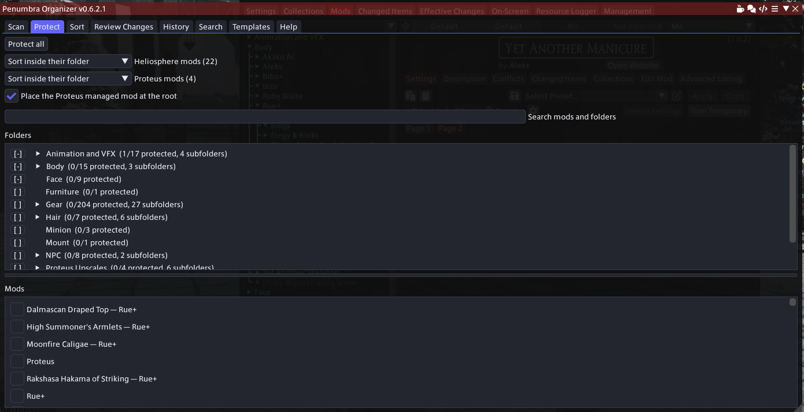

# Penumbra Organizer

Penumbra Organizer is an in-game Dalamud plugin for FINAL FANTASY XIV that helps you organize your
installed [Penumbra](https://github.com/xivdev/Penumbra) mods without manually editing Penumbra's
files.

It communicates with Penumbra through its IPC interface and lets you preview proposed changes
before applying them.



## Features

**Sorting**

* Organize mods by creator, mod type, or a combination of both
* Split gear by equipment slot, NPC mods by kind, and hair by the hair number it replaces
* Put gear in folders named after the body it was made for, so everything that fits one body sits
  together: Gear/Bibo+/Top, Gear/TBSE/Legs. Knows 30 bodies, and you can add your own
* Assign folders to specific mods by hand, or import a layout you edited in Excel
* Review every proposed folder change before applying it — nothing moves until you press Apply

**Protection**

* Protect individual mods from sorting
* Protect a whole folder and everything under it, at any depth
* Or **exclude** one subfolder so it sorts while its parent stays protected — the nearest rule on a
  path wins, so protection is no longer all-or-nothing down a branch
* Clear every kind of protection inside one folder in a single confirmed action
* Automatically protect mods managed by [Heliosphere](https://heliosphere.app/)

**Safety nets**

* Create multiple rollback snapshots and restore any previously saved library state
* Every Apply and Restore snapshots your library first, so both are undoable
* Remove empty folders left behind after mods are reorganized, with its own rollback

**Everything else**

* Export your mod organization to an Excel workbook, and import an edited one back
* Share a folder layout as a template, or preview someone else's against your library first
* Search your whole library to find which installed mods change a given game item

## Installation

Penumbra Organizer is currently distributed through a custom Dalamud plugin repository.

1. Open Dalamud settings using `/xlsettings`.
2. Select the Experimental tab.
3. Add the repository URL shown below to the custom plugin repositories list.
4. Click the + button.
5. Click Save and Close.
6. Open the Dalamud Plugin Installer.
7. Find Penumbra Organizer under Available Plugins and install it.

Repository URL:

```text
https://raw.githubusercontent.com/monstersghost/PenumbraOrganizerPlugin/main/repo.json
```

**Important:** Do not install the plugin by downloading the release archive and extracting it into
the `devPlugins` folder. Manual installations do not receive normal update notifications and must
be updated by hand. They may also conflict with the custom-repository version. Remove any manually
installed copy before installing Penumbra Organizer through the repository.

Once it's installed, see [docs/USER_GUIDE.md](docs/USER_GUIDE.md) for how to use each tab, with a
screenshot of every one. The same guide is available as a
[PDF](docs/USER_GUIDE.pdf) for reading away from the game or printing, and both are linked from the
plugin's own **Help** tab.

## Support

Found a bug, hit unexpected behavior, or have a feature idea?

* **[Join the Discord](https://discord.gg/NHssF8ux6B)** - the fastest way to get help, and where
  releases and testing builds are announced.
* Or [open a GitHub issue](https://github.com/monstersghost/PenumbraOrganizerPlugin/issues).

The same Discord link is on the plugin's own **Help** tab, alongside the full guide and the
walkthrough.

If you are reporting a crash or something the plugin did to your mod list, attach
`%APPDATA%\XIVLauncher\dalamud.log` - it is by far the most useful thing to send.

## Contributing

Contributions are welcome, but please open an issue before beginning implementation. Discussing
the change first helps confirm that it fits the project's scope and may reveal a better approach
that benefits more users.

For build instructions and contributor documentation, see
[docs/DEVELOPMENT.md](docs/DEVELOPMENT.md).
