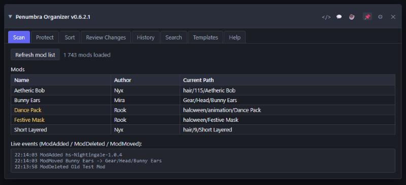
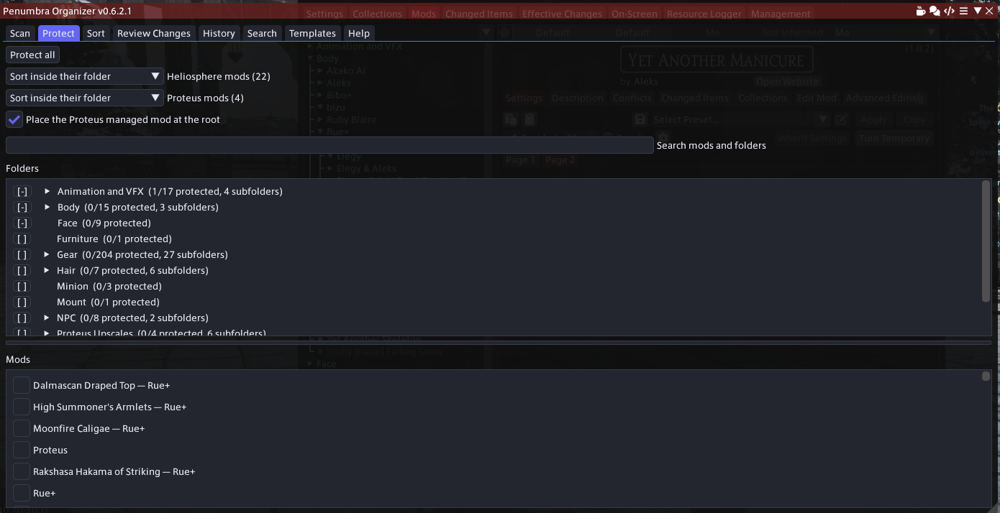
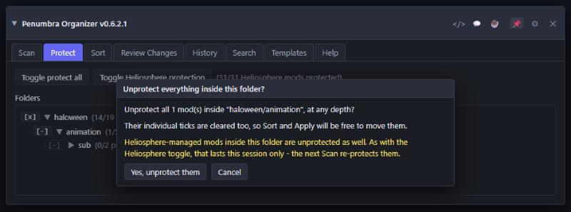
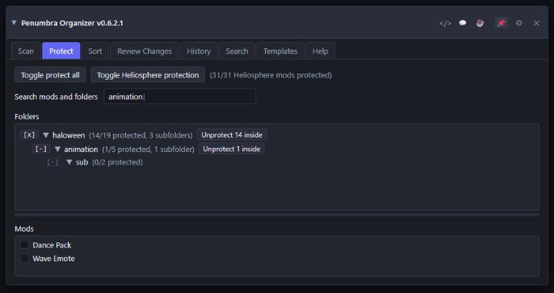
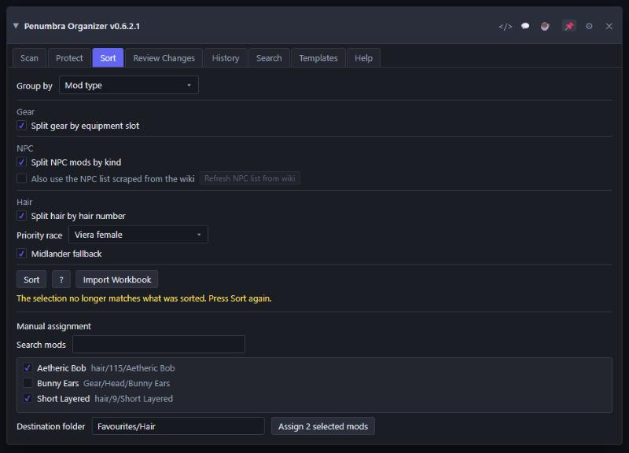
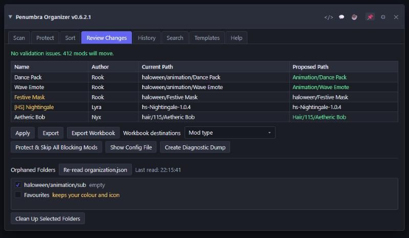
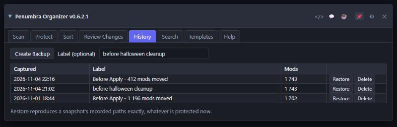
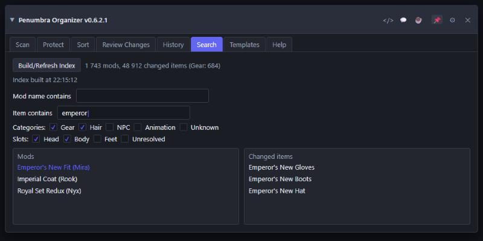
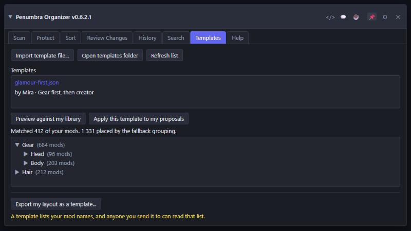

# User Guide

How to use the Penumbra Organizer plugin, tab by tab. For what the plugin is and why it exists,
see the main [README.md](../README.md). For the classification and sort logic mentioned below,
see [HOW_SORTING_WORKS.md](HOW_SORTING_WORKS.md).

## Getting the plugin

Most users should install through the self-hosted plugin repository described in
[README.md](../README.md#installing). That's the supported path, and it auto-updates. If you're
building from source or loading a local dev build instead, see
[DEVELOPMENT.md](DEVELOPMENT.md).

## Title bar

Three icon buttons sit in the title bar, to the left of Dalamud's own icons. Each opens a page in
your browser:

- **Code icon:** the plugin's GitHub repository.
- **Chat icon:** the Discord server, for help.
- **Mug icon:** the Ko-fi page, if you want to support the project.

Hover over each one to see what it opens.

## About the pictures

The screenshots below are rendered from a faithful mock of the plugin's window (`docs/ui-mock/`),
using the plugin's own colours and the exact control labels from its code. They show the layout and
wording you will see; your own numbers, mod names and folder names will differ.

## Requirements

Dalamud, via XIVLauncher. Penumbra installed and enabled: every tab depends on Penumbra's IPC
being available, and if Penumbra isn't running, Refresh mod list shows a connection error instead
of a mod list.

## The eight tabs

### Scan

This is where every session starts. Nothing anywhere else in the plugin updates by itself.

#### Refresh mod list

Re-reads every installed mod from Penumbra (`GetModList`) along with its full changed-items set
(`GetChangedItems`), then classifies each one. See
[HOW_SORTING_WORKS.md](HOW_SORTING_WORKS.md) for how classification works.

Run it first, and run it again whenever mods are installed, removed, or moved outside the plugin.
Scanning never moves anything; it only reads.

#### While a scan runs

The scan runs in the background, so the game keeps responding. A progress line replaces the button
while it works, with a Cancel button beside it. Cancelling leaves your previously loaded library
exactly as it was.

Anything that would collide with a running scan is disabled while it runs, each with a note saying
why: Apply, Restore, Create Backup, Folder Cleanup, the Sort controls, and Import Workbook.

Two situations end a scan early, both on purpose:

- **Your mod list changed mid-scan.** If you add, remove, or move a mod in Penumbra while a scan is
  running, its results no longer describe your library, so they are discarded rather than shown.
  You are told the mod list changed and asked to run it again.
- **The mod list changed during the initial snapshot.** The scan stops straight away rather than
  spending time on a snapshot that may already be out of date.

Neither leaves anything half-applied. A discarded scan simply leaves the previous one in place.

#### What the tab shows afterwards

A count of how many mods are loaded, and the library itself: name, author and current path.
Protected mods are drawn in the protected colour, so you can see at a glance what Sort will leave
alone.

At the bottom, **Live events (ModAdded / ModDeleted / ModMoved)** reports those events as Penumbra
raises them. It is informational only — it does not trigger a re-scan, which is why the rule above
is to scan again yourself after installing mods.

#### If Penumbra is not available

Every tab depends on Penumbra's IPC. If Penumbra is not running or not enabled, Refresh mod list
reports a connection error instead of a mod list. Start Penumbra and scan again.

### Protect

Protection is what stops the plugin proposing a move for a mod. A protected mod keeps its current
path through every Sort and is skipped by Apply. Nothing on this tab moves anything by itself.

A search box at the top filters both lists below it by mod name, author, identifier, current path,
or folder path. Clear it to see everything again.

#### Three sources of protection

A mod is protected if **any** of these is true, and the tab tells you which one applies:

1. **Its own checkbox**, in the Mods list.
2. **A folder rule** covering the folder it sits in. The note beside the mod reads
   `(via folder: Gear)`, naming the folder whose rule actually decided it.
3. **Heliosphere manages it**, shown as `(Heliosphere)`. Heliosphere owns where its mods live, so
   they are re-protected on every scan no matter how you last left the toggle.

These are independent. Freeing a mod means clearing whichever source is protecting it, which is why
the notes name the source rather than only saying "protected".

#### The folder tree

**Folders** shows every folder your mods occupy, plus any folder that carries a rule but no longer
holds anything, as a collapsible tree. Click the arrow to open a folder. Each row shows how many of
its mods are protected out of how many it holds at any depth, and how many subfolders are under it.
Folders you open stay open the next time you open the window. The list is resizable: drag the thin
bar just below it.

Every row has one box with three states, and clicking it cycles through them:

| Box | Meaning |
| --- | --- |
| `[ ]` | **No rule.** This folder follows whatever the nearest folder above it says. |
| `[x]` | **Protected.** Nothing in this folder or below it is moved. |
| `[-]` | **Excluded.** This folder and everything below it may be sorted, *even if a parent is protected.* |

**The nearest rule wins.** A rule applies down the tree until a deeper folder sets its own. That is
what makes "protect this folder, except that one subfolder inside it" possible, and you can keep
nesting: protect `haloween`, exclude `haloween/animation`, then protect `haloween/animation/keep`
inside that if you want.

A **dim** box means the state was inherited from a folder above; hover it to see which one. A
**solid** box means this folder sets its own rule. Clicking a dim box gives that folder its own rule
first, so going from an inherited `[x]` to an excluded `[-]` takes two clicks: the first click's
only visible effect is the box turning solid.

A folder that still carries a rule after its mods have moved away is listed as **(currently
empty)**, so a rule can never become invisible.

#### What an exclude does not free

An exclude withdraws the **folder's** protection and nothing else. Inside an excluded folder, a mod
you ticked yourself stays protected, and so does a Heliosphere-managed one. That is deliberate:
those are per-mod decisions, and a folder rule has no business reversing them silently.

To clear those as well, use the **Unprotect N inside** button on the folder's row. It clears
protection from every mod under it at any depth whatever the source - its own tick, Toggle protect
all, a folder rule, or Heliosphere - and asks first.

The count on the button is what it can actually free, so if there is nothing left to free there is
no button. Three details worth knowing:

- On a folder you have **excluded**, the button leaves the exclude in place and clears only the
  per-mod protection inside. If it withdrew the exclude, the subfolder would fall straight back
  under its protected parent and everything you just freed would be re-protected.
- The button never overrides a protected parent on its own. Escaping a parent is the box's job, and
  takes a deliberate click.
- Unprotecting Heliosphere mods this way lasts the session only: the next Scan re-protects them.

#### Searching the tree

Typing in the search box narrows the tree to the branches that match and opens them for you, so a
match several levels down is visible without digging. Clearing the search puts the tree back exactly
as you had it - what a search opens is never saved. While a search is running, folders stay open.

#### The Mods list

**Mods** lists every scanned mod with its own checkbox, in its own scrollable area below the
folders. A protected mod is excluded from every grouping and from Apply: its proposed path always
stays equal to its current path, and if anything does touch a protected mod, Review Changes flags it
as a "protected mod changed" error.

Toggle protect all is a true toggle: it protects everything if anything is currently unprotected,
and unprotects everything otherwise. Toggle Heliosphere protection does the same, scoped to
[Heliosphere](https://heliosphere.app/)-managed mods (detected by the `hs-` directory prefix, by
Heliosphere's `[HS] ` name prefix, by a `heliosphere.json` file in the mod folder, or by having been
recognised as Heliosphere's on any earlier scan; see [TECHNICAL_SPEC.md](TECHNICAL_SPEC.md)). That
last one matters during a Heliosphere update, which briefly removes the mod's folder and writes a
new one - without it, a scan landing in that moment would see an ordinary mod and offer to move it.

Manually unprotecting a non-Heliosphere mod persists across scans; that choice, along with your
folder rules, is saved to the plugin's own config.

#### Two things that catch people out

**Protected mods at the top level.** If any protected mods sit at the very top level of your
library, outside every folder, the tab says so in yellow. That combination is a dead end: protection
means the plugin never proposes a path, so sorting will never file them away and they stay there
indefinitely. Heliosphere installs new mods there and they are protected by the same scan that first
notices them, so this can happen without you doing anything. Untick one and it sorts like any other
mod.

**Protect all, then free one folder.** Toggle protect all writes a tick on every *mod* and ticks no
folder, so there is no folder to untick afterwards and Sort reports "apply to 0 mods". The way to do
it is Toggle protect all, then **Unprotect N inside** on the one folder you want filed away.

Protection governs Sort and Apply only. Restoring a snapshot from the History tab reproduces its
recorded paths regardless of current protection. See History below.

### Sort

Choose a grouping, tick whichever splits you want, and press Sort. That computes a proposed folder
path for every unprotected mod **without moving anything**. Only Apply, on the Review Changes tab,
calls Penumbra.

The controls are grouped into Gear, NPC and Hair with a rule between each group. The **?** button
beside Sort opens the Help tab at its Sort section.

#### Group by

This picks the shape of the path:

| Choice | Result |
| --- | --- |
| Creator | `{Creator}/{ModName}` |
| Mod type | `{Category}[/{SubCategory}]/{ModName}` |
| Type then creator | `{Category}[/{SubCategory}]/{Creator}/{ModName}` |
| Creator then type | `{Creator}/{Category}[/{SubCategory}]/{ModName}` |

A mod with no resolvable creator, category, or both, falls back to `Review/{ModName}`, so it is
easy to find and sort by hand instead of landing somewhere unexpected.

All three split checkboxes are greyed out when Group by is Creator, because grouping by creator
alone never looks at a mod's type.

#### The three splits

**Split gear by equipment slot** puts gear mods in `Gear/Feet`, `Gear/Head` and so on, wherever the
slot can be determined from a single unambiguous match. Anything ambiguous — a real multi-piece
outfit — or unidentifiable falls back to the plain `Gear` folder. The Export on Review Changes
breaks down how many resolved, how many were ambiguous, and how many had no equipment evidence at
all, which is the fastest way to find out why a mod did not land where you expected.

**Split NPC mods by kind** puts NPC mods in `NPC/NPCs`, `NPC/Bosses` or `NPC/Enemies`. Turning it
**off puts every NPC mod straight into `NPC`** with no subfolder. That combination did not exist in
earlier versions, where NPC mods were always subdivided; if you preferred the old behaviour, leave
it ticked, as it is by default.

**Split hair by hair number** puts a hair mod in a folder named after the vanilla hair number it
replaces, such as `Hair/115`, when the mod targets exactly one number. A mod that targets two or
more numbers, or whose files could not be read, stays directly in `Hair`, as does every hair mod
while this is off. The numbers come from the mod's own configuration, not its name. It is off by
default. Penumbra sorts folders as text, so `Hair/9` appears after `Hair/115`; that is expected.

Two controls appear under it, and both apply only while Split hair is on:

- **Priority race.** Pick a race and gender. A hair mod that uses exactly one hair number for that
  race is filed under that number, whatever the other races use — a mod using 169 for most races
  and 3 for Viera goes to `Hair/3` with Viera female chosen.
- **Midlander fallback.** When a mod uses different numbers across races, this uses the Midlander
  number if male and female Midlanders agree.

Both reset each session. A mod that still does not resolve to one number stays in the plain `Hair`
folder; a race with two hair numbers in the same mod never picks one.

#### The NPC list controls

**Also use the NPC list scraped from the wiki** is off and unavailable in this version. NPC name
recognition works from a curated list shipped with the plugin, which needs no setup and no network
access. The opt-in exists for a much larger scraped list; it recognises far more character names at
the cost of matching some very common words, and stays disabled until that is verified in game.

**Refresh NPC list from wiki** is likewise off in this version. When enabled, it rewrites the
opt-in scraped list — not the bundled one — with whatever the wiki returns on that run, so names
the wiki no longer lists are dropped rather than accumulating. Results are shown per category as a
name total, or a failure reason; a category whose scrape fails keeps what it already held rather
than being emptied.

#### After sorting

If you change the grouping or any checkbox after sorting, a line appears reminding you that the
selection no longer matches what was sorted. Press Sort again to bring the proposals up to date.
Sorting again always recomputes from scratch, so it is safe to press repeatedly.

#### Import Workbook

Opens a file picker for an `.xlsx` exported either from this plugin or the standalone app, and
applies its per-mod destination folders as proposed paths. Use it instead of the built-in groupings
when you want to hand-edit an assignment list in Excel first. A summary line, plus any errors or
warnings, appears below the button once the import finishes.

#### Manual assignment

The bottom of the tab assigns a folder to specific mods. Its own **Search mods** box filters the
list below it, the same way the Protect tab's does. Check the mods you want — protected mods never
appear here — type a destination folder, and click **Assign N selected mods**. Each checked mod's
proposed path becomes `{destination}/{ModName}`.

A summary line reports how many were assigned and how many were skipped, for example because a mod
stopped being eligible after you checked it, or because you left the folder box empty. Your checked
selection survives changes to the search box, so you can filter down, check some mods, clear the
filter, and check more without losing what you already picked.

### Review Changes

The gate between a proposal and your actual library. Everything above this tab is reversible by
doing nothing; this is where you commit.

#### The validation line and the table

The top line is the result of `Validate()`. Any **protected-mod-changed** or **path-collision**
errors are listed in red, and Apply stays disabled while any exist. The table below shows every
mod's current path beside its proposed path, so you can read the whole change before committing.

- A **protected mod changed** error means something assigned a proposed path to a mod you
  protected. It is a bug-catcher: protection is supposed to make that impossible.
- A **path collision** means two mods would end up at the same path. Penumbra would reject or
  mangle one of them, so the plugin refuses first.

**Protect & Skip All Blocking Mods** is the one-click fix: every mod currently blocking Apply —
whether protected-but-changed or on the losing side of a collision — has its proposed path reset to
its current path and gets protected. Apply becomes available without you tracking down each one.

#### Apply

Apply is disabled while any validation issue exists. When you click it, a confirmation popup shows
how many mods will move; confirming calls Penumbra's `SetModPath` for every mod whose proposed path
differs from its current path.

The result shows a succeeded and failed count, with Penumbra's own error code as the reason for
each failure, for example `PathRenameFailed`. Apply also captures a snapshot of your library just
before it runs, so you can always get back to where you started — see History below.

#### Exports

- **Export** writes every mod's full field set plus the validation result to a plain-text file
  (`organizer-export.txt`, overwritten each time). If any of your mods are Gear, it adds the
  one-line slot-resolution summary described under Sort. It is a snapshot to read, not something to
  re-import.
- **Export Workbook** writes `organizer-workbook.xlsx`, interoperable with the standalone app: edit
  it in Excel, then use Import Workbook on the Sort tab to bring your edits back. **Open Workbook**
  opens the file you just wrote.
- **Workbook destinations** decides what goes in the workbook's Destination column. The four
  sorting choices fill it with suggested folders; **Keep current folders (as-is)** fills it with
  each mod's folder as it stands, which is what you want when you intend to write the layout
  yourself. Protected mods and mods at the top level of your library get a blank Destination, which
  means "leave this one alone" on import.

#### Diagnostics

**Show Config File** opens Explorer with the plugin's own settings file (your protected mods and
folder rules) selected, so you can copy or attach it. **Create Diagnostic Dump** writes a
plain-text state summary — mod and protection counts, the last Apply/Restore/Folder Cleanup result
including one from a previous session, and the session's event log — to `organizer-diagnostics.txt`,
and **Show Dump File** opens Explorer with it selected. Attach that file when reporting a problem.

#### Orphaned Folders

Below a separator, this section appears once you have scanned at least once. It finds folder entries
left behind in Penumbra's own `organization.json` after a mod moved out of them.

**Re-read organization.json**, with a "Last read" timestamp beside it, re-reads the file from disk.
It does **not** ask Penumbra to refresh its own live folder tree, which is why the count can look
wrong right after a big Sort or Restore. If it does, move one folder in Penumbra's own UI (or click
its Rediscover Mods) and re-read.

Plain empty folders are pre-checked. Folders that still carry your own customization — an icon,
colour, or name override — are shown unchecked for you to review before pruning, because deleting
one throws that customization away.

**Clean Up Selected Folders** removes the checked entries, with its own backup and **Rollback
Folder Cleanup** pair, separate from Apply's history. Afterwards a banner reminds you to click
Rediscover Mods in Penumbra's settings, since this plugin has no IPC call that can trigger that
reload itself.

### History

The undo for everything this plugin does to your library.

#### What gets captured

Every Apply and every Restore automatically captures a snapshot just before it runs, so both are
undoable. You can also click **Create Backup** at any time, with an optional label, to save one on
demand — worth doing before a big reorganisation you are unsure about.

Each entry shows when it was captured, its label or an auto-generated description such as "1723
mods moved", and how many mods it covers. History persists across game restarts.

#### Restoring

Clicking **Restore** opens a confirmation with an exact preview:

- how many mods will move to their snapshot path;
- how many are already at it;
- how many, installed since the snapshot was taken, will be moved to the Penumbra root;
- how many, uninstalled since, will be skipped.

If any mods in that preview are currently protected or Heliosphere-managed, a warning line tells you
how many will move anyway.

That is deliberate: **Restore ignores protection.** A snapshot is a record of where your mods were,
and current sort protection should not be able to stop you getting back to it. Only two things stop
a mod being restored — it is no longer installed (reported as skipped), or Penumbra's `SetModPath`
rejects the move (reported as failed, with Penumbra's error code).

Confirming a Restore captures its own pre-restore snapshot first, so a restore is itself undoable.

#### Delete

Removes a snapshot from the list. Restoring to any other snapshot still works normally afterwards.
Deleting a snapshot does not touch your mods.

### Search

A read-only reverse lookup: find every installed mod, enabled or not, by the game items it changes.
It is independent of the Sort tab, builds its own index, and never moves, protects, or modifies
anything.

#### Build/Refresh Index

Scans your installed mods and their changed-items sets into a searchable index. This is **separate
from the Scan tab's scan**, so click it once here before searching, and again after installing or
removing mods. A summary line reports what was indexed — mod count, total changed items, and a
gear-slot breakdown — with the build time beneath it.

Like the Scan tab's scan, it runs in the background with a progress line and a Cancel button, and
is discarded if your mod list changes while it is running.

#### Narrowing the results

- **Mod name contains** matches the mod's name.
- **Item contains** matches the names of the items it changes.
- **Categories** filters by mod category, with an Unknown toggle for mods that did not classify.
- **Slots** appears when Gear is among the selected categories, filtering Gear mods by equipment
  slot, plus an Unresolved toggle for Gear mods whose slot could not be determined.

#### Reading the results

The left pane lists matching mods as `Name (Author)`; click one to select it. The right pane lists
that mod's changed items.

If a mod matched only because of the **Mod name contains** box and not because of any item, a red
"Matched by mod name, not by item" note appears above its item list. That distinction matters when
you are hunting for which mod touches an item: a name hit is a coincidence of naming, an item hit is
the real answer.

### Templates

A template is an organization layout someone else shared as a `.json` file. Importing one proposes
where your mods would go: mods you and the template's author both have land in the folder they
chose, and everything else is placed by the fallback sort strategy they picked, using their folder
names.

#### Using someone else's template

1. Get a template file from whoever shared it and click **Import template file...**, or drop the
   file into the templates folder yourself (**Open templates folder** shows you where) and click
   **Refresh list**.
2. Select it in the list to see who made it and what it is for.
3. Click **Preview against my library**. You get a count of how many of your mods the template
   matched, how many its fallback strategy placed, and a browsable tree of the resulting folders
   with the number of mods in each.
4. If it looks right, click **Apply this template to my proposals**, then open **Review Changes**
   to check the result and apply it like any other sort.

Nothing is written to Penumbra until you apply from Review Changes, exactly as when you sort from
the Sort tab.

A few things worth knowing:

- **A template never sees your mod list.** It matches on mod names, so it only affects mods you
  already have. Mods its author never had are placed by the fallback strategy, not left behind.
- **Matching is on the mod's name**, ignoring case, install suffixes like `_1_1_0`, and bracketed
  tags. A mod you renamed will not match, and will be placed by the fallback strategy instead.
- **Protected mods are never moved**, the same as with any sort.
- If you rescan your library after previewing, the preview is discarded — preview again before
  applying.

#### Sharing your own layout

**Export my layout as a template...** builds a template from your library.

Read this part before you use it: **a template contains a list of your mod names, and anyone you
send it to can read that list.** That is the whole point of the format — it is how an importer knows
which of their mods you have an opinion about — but it means exporting is publishing. If any of your
mods are things you would not want a stranger, or a friend, reading off a list, take them out first.

That is what the review screen is for, and there is no way to export without going through it:

1. Click **Export my layout as a template...**. The screen opens with **everything included**, so
   what you see is your actual library.
2. Give it a name, and optionally your name and a description.
3. Pick the **fallback grouping** — where an importer's mods go when your template says nothing
   about them. These are the same choices the Sort tab offers.
4. Go through the folder and mod lists and untick anything you would rather not share. Unticking a
   folder also unticks the mods in it. The search box narrows what you are looking at; **Include
   all** and **Exclude all** always apply to every mod, not only the ones showing.
5. Then either **Save to templates folder**, which writes a `.json` you can send to anyone, or
   **Copy share code**, which puts the whole template on your clipboard as one line of text.

Some things worth knowing:

- **Export uses where your mods are now**, not any proposals sitting on Review Changes. If you have
  sorted but not applied, the template describes your *old* layout, because that is the one your
  library actually has. The screen says so.
- **Share codes only work for small templates.** A chat message holds about 2000 characters, which
  is roughly a hundred mods. Past that the button is disabled and the screen tells you the length —
  send the file instead.
- **Mods sitting loose at the top level are left out.** A template only carries folders, so a mod
  that is not in one has nothing to record. The screen tells you how many.
- If two of your mods have names that match once suffixes and tags are stripped, and they are in
  *different* folders, that name is left out and the screen says so — a template cannot say two
  things about one name. Exclude one of them to include the other.

### Help

Every explanation the plugin holds, at reading length rather than tooltip length. It is grouped into
collapsible sections: what the plugin does, what is and isn't safe, one section per tab, what to do
if an operation was interrupted, and where your files live.

Each tab's section lists that tab's controls with the same one-line explanation you get by hovering
them, so the Help tab doubles as a reference for anything you saw a tooltip on and want to find
again.

#### The three buttons

"Join the Discord for support" opens the project's Discord in your browser. That is the fastest
place to get help, and where releases and testing builds are announced.

"Open the full guide in your browser" opens this document, pinned to the release you're running
rather than to the latest one, so it always describes the version you actually have.

"Show the walkthrough" reopens the guided first run, the five-step tour shown the first time you
open the plugin. It can be reopened as often as you like.

If you upgraded to 0.6.0 from an earlier version, that walkthrough runs once for you too. That is
deliberate rather than a mistake: 0.6.0 replaced the whole Sort control, changed how NPC names are
matched, and added this tab, so there is as much new for an existing user as for a new one. Dismiss
it and it will not return.

Nothing on this tab changes anything - it reads no mods and writes no files.

## Hair

Hair mods that ship one folder per race can be filed under the hair number most races use. All
three controls — Split hair by hair number, Priority race, and Midlander fallback — are on the Sort
tab and are described under [Sort](#sort) above. Both extra controls apply only while Split hair is
on, and both reset each session.

Read the caveat at the bottom of this page before trusting the numbers on a library you care about.

## Typical workflows

First-time sort: Scan, choose a grouping on the Sort tab and press Sort, review the proposed paths
on Review Changes, then Apply.

New mods installed since the last sort: Scan again (this picks up the new mods; previously-set
protection carries over), press Sort again, review, then Apply.

Hand-tuning through Excel: on Review Changes, Export Workbook, edit destinations in Excel, then on
the Sort tab Import Workbook, review again, then Apply.

Protecting a folder but letting one subfolder sort: on the Protect tab, click the parent folder's
box until it shows a solid `[x]`, open it, then click the subfolder's box twice - once to give it
its own rule, once more to make it `[-]`. Sort, and only that subfolder's mods are proposed for
moving. If some mods in there are still protected by their own tick or by Heliosphere, use Unprotect
N inside on that subfolder to clear those too.

Undoing an Apply, or going back further: open the History tab and Restore the snapshot from just
before the Apply (or any earlier one). Protection doesn't block this, so it works even for mods
you've since protected.

After moving mods around inside Penumbra directly: Scan, check the Orphaned Folders section on
Review Changes, Clean Up Selected Folders, click Rediscover Mods in Penumbra, then Scan again to
confirm.

Finding which mod changes a given item: open the Search tab, Build/Refresh Index, type part of the
item name into "Item contains", then click a matching mod to see its full changed-items list.

## Where files live

Everything the plugin writes lives under Dalamud's per-plugin config directory:
`organizer-history.json` for rollback snapshots (Apply, Restore, and manual backups all share this
one multi-snapshot history), `organizer-folder-backup.json` for Folder Cleanup's own separate
rollback data, `organizer-export.txt` for the plain-text Review export, `organizer-diagnostics.txt`
for the diagnostic dump, `organizer-workbook.xlsx` for the last exported workbook, and
`npc-name-list.json` for the NPC/enemy/boss name list, which is seeded on first run and updated in
place by Refresh. Your protected mods and protected folders live in the plugin's own Dalamud
settings file (reachable via Show Config File on the Review Changes tab), not in this directory.
The plugin never writes inside Penumbra's own mod storage, with one exception covered in
[TECHNICAL_SPEC.md](TECHNICAL_SPEC.md): Folder Cleanup's edits to `organization.json`.

## Known caveats

See [ROADMAP.md](ROADMAP.md) for the current status. The child-race-variant NPC classification fix
is implemented but not yet confirmed against a real, in-game mod library. The NPC wiki-refresh path
has no automated test coverage. Folder Cleanup detection can appear stale immediately after a large
Sort or Restore. See the Review Changes section above for why, and for how to force a re-check.

Hair numbers are read from the mod's files, and also from the EST entries in its metadata. The EST
value has not yet been confirmed in game to be the hair number. If a mod is filed under a number that
is not the hair it replaces, turn Split hair off and report the mod name and both numbers on Discord.
