# User Guide

How to use the Penumbra Organizer plugin, tab by tab. For what the plugin is and why it exists,
see the main [README.md](../README.md). For the classification and sort logic mentioned below,
see [HOW_SORTING_WORKS.md](HOW_SORTING_WORKS.md).

## Getting the plugin

Most users should install through the self-hosted plugin repository described in
[README.md](../README.md#installing). That's the supported path, and it auto-updates. If you're
building from source or loading a local dev build instead, see
[DEVELOPMENT.md](DEVELOPMENT.md).

## Title bar

Three icon buttons sit in the title bar, to the left of Dalamud's own icons. Each opens a page in
your browser:

- **Code icon:** the plugin's GitHub repository.
- **Chat icon:** the Discord server, for help.
- **Mug icon:** the Ko-fi page, if you want to support the project.

Hover over each one to see what it opens.

## About the pictures

The Sort tab pictures and the Penumbra trees under [The result in Penumbra](#the-result-in-penumbra)
are in-game screenshots. The other screenshots are rendered from a faithful mock of
the plugin's window (`docs/ui-mock/`), using the plugin's own colours and the exact control labels from
its code. They show the layout and wording you will see; your own numbers, mod names and folder names
will differ.

## Requirements

Dalamud, via XIVLauncher. Penumbra installed and enabled: every tab depends on Penumbra's IPC
being available, and if Penumbra isn't running, Refresh mod list shows a connection error instead
of a mod list.

## The eight tabs

### Scan

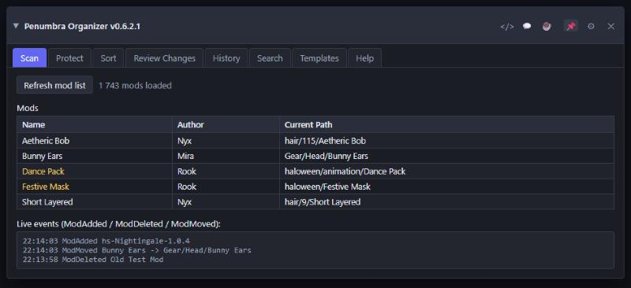

This is where every session starts. Nothing anywhere else in the plugin updates by itself.

#### Refresh mod list

Re-reads every installed mod from Penumbra (`GetModList`) along with its full changed-items set
(`GetChangedItems`), then classifies each one. See
[HOW_SORTING_WORKS.md](HOW_SORTING_WORKS.md) for how classification works.

Run it first, and run it again whenever mods are installed, removed, or moved outside the plugin.
Scanning never moves anything; it only reads.

#### While a scan runs

The scan runs in the background, so the game keeps responding. A progress line replaces the button
while it works, with a Cancel button beside it. Cancelling leaves your previously loaded library
exactly as it was.

Anything that would collide with a running scan is disabled while it runs, each with a note saying
why: Apply, Restore, Create Backup, Folder Cleanup, the Sort controls, and Import Workbook.

Two situations end a scan early, both on purpose:

- **Your mod list changed mid-scan.** If you add, remove, or move a mod in Penumbra while a scan is
  running, its results no longer describe your library, so they are discarded rather than shown.
  You are told the mod list changed and asked to run it again.
- **The mod list changed during the initial snapshot.** The scan stops straight away rather than
  spending time on a snapshot that may already be out of date.

Neither leaves anything half-applied. A discarded scan simply leaves the previous one in place.

#### What the tab shows afterwards

A count of how many mods are loaded, and the library itself: name, author and current path.
Protected mods are drawn in the protected colour, so you can see at a glance what Sort will leave
alone.

At the bottom, **Live events (ModAdded / ModDeleted / ModMoved)** reports those events as Penumbra
raises them. It is informational only — it does not trigger a re-scan, which is why the rule above
is to scan again yourself after installing mods.

#### Unused mods

A collapsed **Unused mods** section at the bottom of the tab finds mods that no collection enables.
Press **Check unused mods**; tick **Only my active collection** first to check that one collection
instead of all of them. A line names the collections it read (temporary settings from other plugins
are ignored), and the list shows each unused mod with its current path and its size on disk. Checking
only reads; nothing changes.

Tick the mods you want to set aside (**Select all** and **Select none** help) and press **Move N
selected to Unused**. That stages them under an `Unused` folder, keeping their folder structure
(`Unused/Gear/02. Top/...`), and moves nothing until you apply on Review Changes. Protected mods are
listed as "protected - will not move" and cannot be ticked. Tick **Protect the Unused folder** before
moving to add a protect rule for that folder, so a later whole-library sort does not pull those mods
back out; the rule shows on the Protect tab.

#### If Penumbra is not available

Every tab depends on Penumbra's IPC. If Penumbra is not running or not enabled, Refresh mod list
reports a connection error instead of a mod list. Start Penumbra and scan again.

### Protect

Protection is what stops the plugin proposing a move for a mod. A protected mod keeps its current
path through every Sort and is skipped by Apply. Nothing on this tab moves anything by itself.

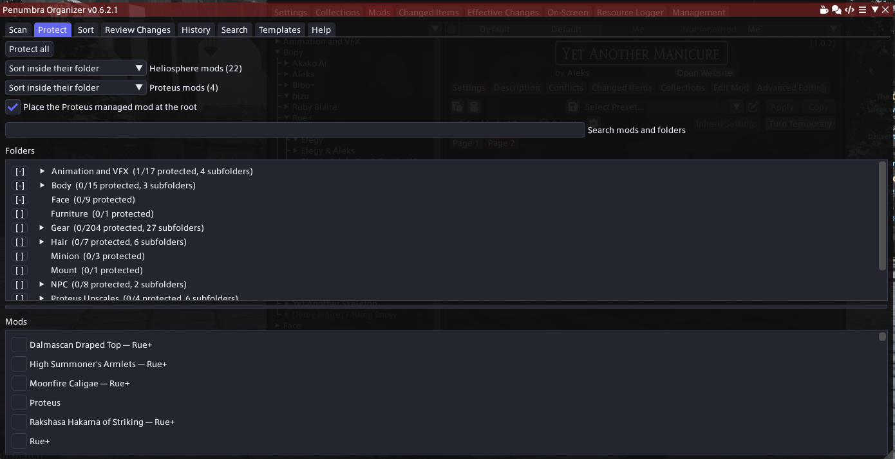

A search box at the top filters both lists below it by mod name, author, identifier, current path,
or folder path. Clear it to see everything again.

#### Three sources of protection

A mod is protected if **any** of these is true, and the tab tells you which one applies:

1. **Its own checkbox**, in the Mods list.
2. **A folder rule** covering the folder it sits in. The note beside the mod reads
   `(via folder: Gear)`, naming the folder whose rule actually decided it.
3. **A tool manages it**, shown as `(Heliosphere)` or `(Proteus)`. By default the plugin leaves
   these mods where they are. You can change that per tool; see
   [Heliosphere and Proteus mods](#heliosphere-and-proteus-mods) below.

These are independent. Freeing a mod means clearing whichever source is protecting it, which is why
the notes name the source rather than only saying "protected".

#### The folder tree

**Folders** shows every folder your mods occupy, plus any folder that carries a rule but no longer
holds anything, as a collapsible tree. Click the arrow to open a folder. Each row shows how many of
its mods are protected out of how many it holds at any depth, and how many subfolders are under it.
Folders you open stay open the next time you open the window. The list is resizable: drag the thin
bar just below it.

Every row has one box with three states, and clicking it cycles through them:

| Box | Meaning |
| --- | --- |
| `[ ]` | **No rule.** This folder follows whatever the nearest folder above it says. |
| `[x]` | **Protected.** Nothing in this folder or below it is moved. |
| `[-]` | **Excluded.** This folder and everything below it may be sorted, *even if a parent is protected.* |

**The nearest rule wins.** A rule applies down the tree until a deeper folder sets its own. That is
what makes "protect this folder, except that one subfolder inside it" possible, and you can keep
nesting: protect `haloween`, exclude `haloween/animation`, then protect `haloween/animation/keep`
inside that if you want.

A **dim** box means the state was inherited from a folder above; hover it to see which one. A
**solid** box means this folder sets its own rule. Clicking a dim box gives that folder its own rule
first, so going from an inherited `[x]` to an excluded `[-]` takes two clicks: the first click's
only visible effect is the box turning solid.

A folder that still carries a rule after its mods have moved away is listed as **(currently
empty)**, so a rule can never become invisible.

#### What an exclude does not free

An exclude withdraws the **folder's** protection and nothing else. Inside an excluded folder, a mod
you ticked yourself stays protected, and so does a tool-managed one (while its mode is Protected). That is deliberate:
those are per-mod decisions, and a folder rule has no business reversing them silently.

To clear those as well, use the **Unprotect N inside** button on the folder's row. It clears
protection from every mod under it at any depth whatever the source - its own tick, Protect all, a
folder rule, or a tool - and asks first.

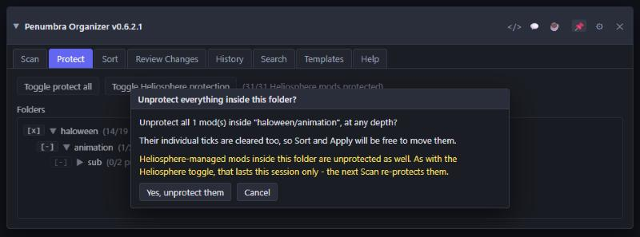

The count on the button is what it can actually free, so if there is nothing left to free there is
no button. Three details worth knowing:

- On a folder you have **excluded**, the button leaves the exclude in place and clears only the
  per-mod protection inside. If it withdrew the exclude, the subfolder would fall straight back
  under its protected parent and everything you just freed would be re-protected.
- The button never overrides a protected parent on its own. Escaping a parent is the box's job, and
  takes a deliberate click.
- Unprotecting a tool's mods this way lasts the session only: the next Scan re-applies the tool's mode.

#### Searching the tree

Typing in the search box narrows the tree to the branches that match and opens them for you, so a
match several levels down is visible without digging. Clearing the search puts the tree back exactly
as you had it - what a search opens is never saved. While a search is running, folders stay open.

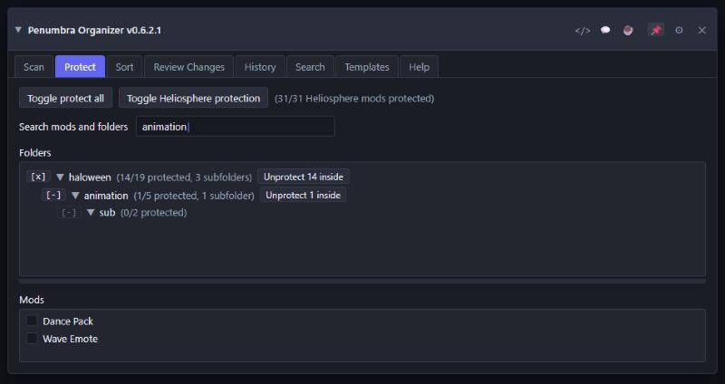

#### The Mods list

**Mods** lists every scanned mod with its own checkbox, in its own scrollable area below the
folders. A protected mod is excluded from every grouping and from Apply: its proposed path always
stays equal to its current path, and if anything does touch a protected mod, Review Changes flags it
as a "protected mod changed" error.

**Protect all** protects every mod; once everything is protected the same button reads **Unprotect
all** and clears every protection, including ones you ticked yourself.

Manually unprotecting a mod persists across scans; that choice, along with your folder rules, is
saved to the plugin's own config.

#### Heliosphere and Proteus mods

[Heliosphere](https://heliosphere.app/) and [Proteus](https://github.com/solona-m/proteus) each
manage some of your mods. Both find their mods by directory rather than by where they sit in
Penumbra's tree, so the plugin may move them, but you choose. When the scan finds mods from a tool,
the Protect tab shows a dropdown for it with the number of mods:

- **Protected** (the default): left exactly where they are.
- **Sort inside their folder**: sorted like any other mod, but kept beneath the top-level folder they
  already sit in (`Proteus Upscales/Gear/Top/...`). Mods at the very top level, or already in one of
  the sorter's own folders such as `Gear`, are sorted normally.
- **Treat as normal**: sorted like everything else.

The choice is saved. A tool with no mods in your library shows no dropdown, so the Proteus controls
appear only once the scan finds a Proteus-made mod. Heliosphere mods are detected by the `hs-`
directory prefix, Heliosphere's `[HS] ` name prefix, a `heliosphere.json` file in the mod folder, or
having been recognised on an earlier scan. Proteus-made mods are the ones whose `meta.json` author is
exactly `Proteus`.

Proteus also keeps one mod of its own, named `Proteus`. Once it exists, the tab offers **Place the
Proteus managed mod at the root**, which files that mod at the very top of the library instead of
inside the Proteus folder.

An explicit protection you set yourself (a ticked mod, or a protected folder) still beats a tool's
mode.

**New Heliosphere and Proteus mods.** Heliosphere puts a newly installed mod at the top level of the
library. The new-mod popup follows these modes: in Protected mode (the default) it has nothing to sort,
so it shows a notice instead ("1 new Heliosphere mod added. Heliosphere mods are Protected, so it stays
where it is. You can change this on the Protect tab.") with **Open Protect tab** and **OK**; in the other
two modes the new tool mods are offered like any other. See
[Auto sort and the new-mod popup](#auto-sort-and-the-new-mod-popup) under Sort. The Sort tab's bar also
repeats both modes in its status line.

#### Sort inside folders

A collapsible list below the Heliosphere and Proteus mode dropdowns on the Protect tab. Pick a folder, at any depth, such as
`.Character specific mods`, and press **Add**. Its mods are sorted again beneath it
(`.Character specific mods/Gear/...`) using your Sort tab settings, with numbering kept per folder.
A sub-folder works too: write it as a path such as `.Character specific mods/Alice`. The deepest chosen folder that contains a mod wins, so choosing both `.Chars` and `.Chars/Alice` keeps Alice's mods under Alice and the rest under `.Chars`. Example: protect `.Character specific mods`, set one character's sub-folder to [-] (excluded) in the folder list, and add that sub-folder here; only that character's mods are re-sorted, the other characters stay untouched. A chosen folder that is still protected is marked, because nothing inside it will move. Protected mods and protected sub-folders stay where they are. Folders that are the sorter's own
(such as Gear) cannot be chosen. **Remove** returns the mods to the normal folders on the next sort.
The list is empty by default. Applying a template keeps mods in a chosen folder under it (as for
Heliosphere and Proteus in Sort inside mode); the template preview does not show that folder prefix
yet, and the workbook export ignores this setting.

#### Two things that catch people out

**Protected mods at the top level.** If any protected mods sit at the very top level of your
library, outside every folder, the tab says so in yellow. That combination is a dead end: protection
means the plugin never proposes a path, so sorting will never file them away and they stay there
indefinitely. Heliosphere and Proteus install new mods there and, in Protected mode, they are
protected by the same scan that first notices them, so this can happen without you doing anything. Untick one and it sorts like any other
mod.

**Protect all, then free one folder.** Protect all writes a tick on every *mod* and ticks no
folder, so there is no folder to untick afterwards and Sort reports "apply to 0 mods". The way to do
it is Protect all, then **Unprotect N inside** on the one folder you want filed away.

Protection governs Sort and Apply only. Restoring a snapshot from the History tab reproduces its
recorded paths regardless of current protection. See History below.

### Sort

*The Sort tab on Recommended. The pinned bar at the top holds the mode switch, Sort, the ? button and
the Heliosphere and Proteus status line. Below it: the Recommended layout card with its example paths,
What Recommended does, the Auto sort card and Manual assignment.*

Choose a layout and press Sort. That computes a proposed folder path for every unprotected mod
**without moving anything**. Only Apply, on the Review Changes tab, calls Penumbra.

The tab has two screens, **Recommended** and **Advanced**. Both sort the same library with the same
saved settings; Advanced only shows more of them. Opening the tab shows Recommended when no category
is customised, otherwise Advanced.

#### The pinned bar

The bar at the top stays in view while the rest of the tab scrolls. From left to right:

- **Recommended | Advanced**, the switch between the two screens. It works even while a scan runs.
- **Sort**, the plugin's purple button. It is greyed while another operation (a scan, an Apply) runs.
- **The scope line**, after a Sort: how many mods it covers, such as "Will sort 1450 of 1723 mods:
  whole library.". With What to sort on loose mods only it also says how many protected root mods stay
  put. When rules ran it adds how many mods they filed ("12 filed by rules."), any rule that was
  skipped because it has a mistake, and any mod a rule left in place because its folder could not be
  built (see [Sort rules](#sort-rules)).
- **?** at the right end, which opens the Help tab at its Sort section.

Under it, "Selection changed since the last sort." appears when you change a split, a folder, a creator
folder, Group by, the race settings or a rule after sorting. Press Sort again to bring the proposals up
to date; sorting always recomputes from scratch, so it is safe to press repeatedly.

**Heliosphere and Proteus status line.** Also in the bar, on both screens, one line repeats the Protect
tab's tool modes, for example "22 Heliosphere mods: Protected (not sorted). 13 Proteus mods: Protected
(not sorted). Change this on the Protect tab.", with an **Open Protect tab** button. It is yellow when
a tool is Protected and has mods (those mods will not be sorted) and grey otherwise, as in "22
Heliosphere mods: Sort inside their folder." A tool is named when it has mods or its mode is not
Protected; the line is hidden when you have no Heliosphere or Proteus mods and both modes are Protected.
The modes are changed only on the Protect tab.

Below the bar come the screen you picked, then (in Advanced only) the **Rules** card, the **Auto sort**
card and **Manual assignment**.

**Everything on this tab is remembered** between sessions: Group by, every category's layout, the race
settings, the hair race, the Midlander fallback, the body priority, the rules and the Auto sort choices.
Only the proposals themselves reset (on a rescan), and What to sort, which is for this session only.

#### Group by and What to sort

Both screens start with the same row. **Group by** picks the shape of the path (see
[Group by](#group-by) below). **What to sort** is either **Whole library**, every unprotected mod, or
**Only loose mods in the root**, which leaves anything already in a folder where it is. What to sort is
not saved.

#### Recommended

**Recommended** is one card: Group by, What to sort, and four live example paths (Gear, Hair, Body and
NPC) that show where such a mod would go, with the type folders, the creator and the split folders in
their own colours. They change as soon as you change Group by or anything in Advanced.

If you have customised a category, a yellow line says how many ("2 categories customised") with **Show
in Advanced**, and the examples show your layout, so the screen never describes a layout the Sort will
not use.

Rules are edited in Advanced only, but they still apply when you sort from Recommended. While any rule
is active (switched on and free of mistakes), Recommended says so ("2 rules active, edit them in
Advanced") with **Show rules**, which opens Advanced with the Rules card open and scrolled into view.

A second card, **What Recommended does**, lists the layout one line per kind of mod: gear by body type,
then slot, with accessories kept out of body folders and hands and feet sharing a folder; hair by hair
number, three digits; body by body type, then part (`Body/10. Bibo+/00. Replacer`); NPC by kind (NPCs,
Bosses, Enemies); emotes by the emote they replace; and one folder per type for everything else, with a
note saying whether Split by race is on. **Customise per category** opens Advanced.

#### Advanced

*Advanced with Gear selected. The list on the left marks customised categories with a Custom badge.
On the right: the folder, the creator folder, the splits with their depth numbers, the live example
and the Body types card. The Rules and Auto sort cards follow below.*

**Advanced** starts with a header: "N of 16 categories customised. Everything else follows
Recommended.", **Select all splits**, **Reset all to Recommended**, then Group by and What to sort.

Below that, the 16 kinds of mod are listed on the left: Gear, Weapon, Face, Hair, Body, Skin, NPC,
Minion, Mount, Pet, Ornament, Furniture, VFX, Sound, Animation and Others. A **Custom** badge marks a
category that differs from Recommended. A category without one follows Recommended, including any later
improvement to it. Pick one and its settings appear on the right, under its name and either **Custom**
with a **Reset to Recommended** button or "Using Recommended":

- **Folder** ("nest with /, for example Equipment/Gear"): the category's top folder, which can be
  nested. It is checked as you type: it must be relative, with no empty part, no `.` or `..`, and at
  most 260 characters. An invalid name shows a red message and is never saved; a valid one is saved
  when you leave the box. A yellow note warns, without stopping the save, when another category uses the
  same folder ("Hair also uses this folder, so those mods share it."), when the folder is inside a
  protected folder (mods filed there would be treated as protected), or when it is inside a sort-inside
  folder. Renaming moves nothing until you Sort and Apply.
- **Creator folder**: **None**, **Before type folders** or **After type folders**. "Follows Group by"
  appears while the category takes its creator folder from Group by. Picking the level Group by already
  gives keeps it following Group by (and does not make the category Custom). Greyed under Group by
  Creator.
- **Splits** ("numbers are the folder depth; the order is fixed"): each split is a switch with a short
  description, and a split that is on shows its folder depth (1, 2, 3) beside it. The order cannot be
  changed. A split that cannot apply right now is greyed, keeps its setting, and its tooltip says why
  (for example under Group by Creator, or a Body race split while Part and body type is off). **Hands and
  feet in one shared folder** is a checkbox under Gear's Equipment slot with no number, because it adds
  no folder of its own. Categories with no split say so.
- **Example**: one live path for the category with your settings, in the same colours as on
  Recommended.

The splits each category has:

| Category | Splits |
| --- | --- |
| Gear | Body type; Equipment slot (with Hands and feet in one shared folder) |
| Weapon | Job |
| Face | Race; Eyes by race |
| Hair | Race; Hair number |
| Body | Part and body type; Tails, ears and horns by race; Racial scaling by race |
| Skin | Race |
| NPC | Kind |
| Animation | Emote |

Some settings sit under the categories they affect:

- **Hair**: **Priority race** and **Midlander fallback**, shown while Hair number is on.
- **Hair, Face, Skin and Body**: the **Race** panel, with **Split by race** (the master switch for every
  race split), **Send multi-race mods to Multi-race** and the collapsed **Race priority** list (arrows to
  reorder, Remove, and **Add a race**). With Split by race on, a line asks you to scan again when some
  face, skin or body mods were scanned before race reading existed.
- **Weapon**: "Scan again so weapon-only mods move between Gear and Weapon." while your mods were
  scanned with the Job split the other way.
- **Gear and Body**: the **Body types** card, holding the collapsed **Body priority** section:
  **First-choice body**, **Check my collection** and the collapsed **Full priority order** with its
  arrows and **Reset to default**.

**Reset to Recommended** puts one category back: folder, creator folder and splits. **Reset all to
Recommended** puts every category back, straight away, without asking; it is greyed while nothing is
customised. Nothing moves until you Sort and Apply.

**Select all splits** asks first, in a window titled "Select all splits?". It lists what it does: every
gear, NPC, hair, body and emote split; weapons by job (scan again to take weapon-only mods out of Gear);
the race split on every category that has one, and **Split by race**; and hands and feet get their own
folders (the shared folder is turned off). Folder names, creator levels, Group by and the priorities stay
as they are, and nothing moves until you press Sort, review the plan and Apply. **Select all** confirms;
**Cancel** or **Escape** closes it without a change.

While a scan or an Apply runs, every control on the screen is greyed with the reason; the mode switch
and ? still work.

Versions before 0.7.1.0 had one checkbox per split instead of the category editor. Your ticks carried
over when you updated. The old checkbox names map to the category splits like this:

| Old checkbox | Category split |
| --- | --- |
| Split gear by equipment slot | Gear: Equipment slot |
| Split gear by body type | Gear: Body type |
| Hands and feet in a shared folder | Gear: Hands and feet in one shared folder |
| Split NPC mods by kind | NPC: Kind |
| Split hair by hair number | Hair: Hair number |
| Split body mods by body type | Body: Part and body type |
| Split emotes by emote | Animation: Emote |
| Race rows | Race in Hair, Face and Skin; Eyes by race in Face; Tails, ears and horns by race and Racial scaling by race in Body |

#### Group by

This picks the shape of the path:

| Choice | Result |
| --- | --- |
| Creator | `{Creator}/{ModName}` |
| Mod type | `{Category}[/{SubCategory}]/{ModName}` |
| Type then creator | `{Category}[/{SubCategory}]/{Creator}/{ModName}` |
| Creator then type | `{Creator}/{Category}[/{SubCategory}]/{ModName}` |

`{Category}` is the category's folder from Advanced (`Gear`, or your own name such as
`Equipment/Gear`), and the split folders go where `[/{SubCategory}]` is. In Advanced each category can
move its creator folder before or after the type folders, or drop it, so one category can differ from
the shape above.

A mod with no resolvable creator, category, or both, falls back to `Review/{ModName}`, so it is
easy to find and sort by hand instead of landing somewhere unexpected.

Every split, and the creator folder, is greyed out when Group by is Creator, because grouping by
creator alone never looks at a mod's type. Everything keeps its setting, and switching Group by back
restores it untouched.

#### The splits

A new install starts on the **Recommended** layout: gear by body type and then slot, with hands and feet in one shared folder; NPC mods by kind; hair by hair number; body mods by body type; emotes by emote. Race stays off until you turn on its master switch. Weapons by job is off. Updating from an earlier version keeps the boxes you had ticked, so nothing moves.

Each split below is named as it appears in Advanced, with its category.

**Gear: Equipment slot** puts gear mods in `Gear/Feet`, `Gear/Head` and so on, wherever the
slot can be determined from a single unambiguous match. Anything ambiguous — a real multi-piece
outfit — or unidentifiable falls back to the plain `Gear` folder. The Export on Review Changes
breaks down how many resolved, how many were ambiguous, and how many had no equipment evidence at
all, which is the fastest way to find out why a mod did not land where you expected.

**NPC: Kind** puts NPC mods in `NPC/NPCs`, `NPC/Bosses` or `NPC/Enemies`. Turning it
**off puts every NPC mod straight into `NPC`** with no subfolder. It is on by default.

**Hair: Hair number** puts a hair mod in a folder named after the vanilla hair number it
replaces, such as `Hair/115`, when the mod targets exactly one number. A mod that targets two or
more numbers, or whose files could not be read, stays directly in `Hair`, as does every hair mod
while this is off. The numbers come from the mod's own configuration, not its name. It is on in
the Recommended layout. Folder numbers are padded to three digits (`Hair/002`, `Hair/053`, `Hair/185`) so Penumbra,
which sorts folders as text, lists them in numeric order. Numbers of 1000 or more are not padded.

*Advanced with Hair selected: the Race split (depth 1) and Hair number split (depth 2), the example
path, Priority race and Midlander fallback, then the Race panel shared with Face, Skin and Body.*

Two controls appear under it, and both apply only while Hair number is on:

- **Priority race.** Pick a race and gender. A hair mod that uses exactly one hair number for that
  race is filed under that number, whatever the other races use — a mod using 169 for most races
  and 3 for Viera goes to `Hair/3` with Viera female chosen.
- **Midlander fallback.** When a mod uses different numbers across races, this uses the Midlander
  number if male and female Midlanders agree.

A mod that still does not resolve to one number stays in the plain `Hair`
folder; a race with two hair numbers in the same mod never picks one.

**Gear: Body type** puts a gear mod in a folder named after the body it was made for, such
as `Gear/Bibo+/Top`. The body comes before the equipment slot, so everything made for one body sits
together instead of being spread across the nine slot folders. It is on in the Recommended layout. The slot split
is separate: turn that off and you get `Gear/Bibo+` with nothing below it.

**Numbered gear folders.** With both gear splits on, `Gear/` is numbered so nothing sits loose:
`00. Sets` (outfits and gear with no single slot), `01. Head`, `02. Top`, `03. Hands`, `04. Legs`,
`05. Feet`, `06. Ears`, `07. Neck`, `08. Wrists`, `09. Rings`, then one folder per body from `10.`,
in Body priority order, such as `10. Rue+` and `11. Bibo+`. Only bodies that have gear get a folder,
and each holds the same numbered slot folders (`10. Rue+/02. Top`). Reordering Body priority, or a
body gaining or losing gear, renumbers the body folders. With only one of the two splits on, the
layout is as before, without numbers.

**Gear: Hands and feet in one shared folder** (on in the Recommended layout; it needs Equipment slot and only does anything with Body type on)
files gloves, gauntlets, boots and nails under `Gear/03. Hands` and `Gear/05. Feet` instead of under
each body, since they fit most bodies. Tops, legs and sets still go under their body. A body that
only had hands or feet mods no longer gets a folder.

**Race** splits are splits of the Hair, Face, Skin and Body categories in Advanced, and their shared
settings are in the **Race** panel under those categories. **Split by race** is a master switch, off by
default and greyed out under Creator grouping. The race splits are Race in Hair, Face and Skin, Eyes by
race in Face, and Tails, ears and horns by race and Racial scaling by race in Body. All of them are on in
the Recommended layout, so turning the master on splits all of them; turn one off in its category to
leave it as it is. If you used the old Split hair by race box, the update turns the master on with only
Hair's race split on, so nothing else moves.

Folders are by race, never by gender, using Midlander, Highlander, Elezen, Miqo'te, Roegadyn, Lalafell,
Au Ra, Hrothgar and Viera, such as `Face/Viera` or `Skin/Miqo'te`. A mod made for one race files under
it. A mod made for several races goes to `Multi-race` while **Send multi-race mods to Multi-race** is
ticked. Untick it and the mod goes under the highest-ranked race it covers in **Race priority**; a race
you do not rank never wins. A mod with no race found, or one that could not be read, always goes to
`Multi-race`. With Hair number also on, the hair number is added below, as in
`Hair/Viera/115`.

Eyes files iris-only face mods under `Face/Eyes/<race>`. Face paint is never split, because its files
carry no race. Tails, ears and horns and Racial scaling need Body's Part and body type split. A mod made only
of racial scaling is filed under Gear today; with Racial scaling ticked it goes to
`Body/03. Racial Scaling/<race>` instead. Face, Eyes, Skin and tails read their race when the library is
scanned, so scan again after updating. Race priority is separate from Priority race under Hair, which only
picks the hair number.

**Animation: Emote** (on in the Recommended layout; greyed out under Creator grouping) breaks
up `Animation and VFX/Emotes`. A mod with one emote goes to `Emotes/<emote name>`, a mod with several
goes to `Emotes/Multiple`, a mod with only facial expressions (Endure, Ponder, Reflect, Big Grin) goes
to `Emotes/Expressions`, and a mod with no emote name goes to `Emotes/Undetermined`. Expressions are
ignored when the mod also has another emote. Templates and the workbook export do not follow this
option yet.

**Weapon: Job** (off in the Recommended layout, on in Select all splits; there was never a checkbox
for it) does two things, so scan again after changing it; the Weapon editor reminds you while your
scan does not match the switch. A scan made with it on
files a weapon-only mod (its files replace a weapon model and no gear or accessory) under Weapon instead of
Gear; a weapon that comes with a bracelet or a set stays in Gear. Sort then puts each weapon in
`Weapon/<job>`, such as `Weapon/SAM`. The job comes from the game's item data for the items the mod changes, in your client language;
a class files with its job (a Gladiator sword is `PLD`), and an Arcanist book, an item several jobs share, or
items that disagree go in `Weapon/Multiclass`. A weapon whose items match no job stays directly in `Weapon`.
Turn it off and scan again to put weapons back in Gear. It is kept only in the category layouts, so an older
plugin version that you go back to forgets it.

What moved and what stopped matching when the numbered gear folders and three-digit hair folders
arrived:

- a) The first sort after updating moves gear and hair folders once. History restores the old layout.
- b) Template `folderLabels` keyed to the old subfolders (`Gear/Legs`, `Gear/Bibo+`, `Hair/2`) stop matching. A key on `Gear` itself still renames the root.
- c) A hair mod protected at `Hair/2` stays there, beside the new `Hair/002`.
- d) Folder protection rules naming the old gear folders no longer match the renamed ones.

**Body: Part and body type** does the same for the body replacers themselves, filing each under
its own body. It is a separate split so you can split one kind and not the other: with only Gear's
Body type on, body mods stay as `Body/<mod>`, and the reverse. With it on, the Body folder is numbered
so it sorts the same regardless of the alphabet: `00. Skeleton`, `01. Physics` and `02. Tails, Ears and
Horns` are shared and sit on top (with `03. Racial Scaling` when Racial scaling by race is on), then
your bodies from `10.` in your Body priority order (only bodies that have body mods), each holding
`00. Replacer`, `01. SFW` (clothing that covers the body, like lingerie) and `02. Hands and Feet`, for
example `Body/10. Rue+/01. SFW/<mod>`. A mod that is not clearly a part stays in Replacer, and a body mod
with no body stays directly in `Body`.

**Check my collection** sits in Body priority, in the Body types card under Gear and Body in Advanced. It reads the mods enabled in
your active collection (the one that affects your character, or Penumbra's selected collection when
that is unavailable) and counts only body replacer mods. If exactly one body is enabled it names it
and offers **Make first choice**; with none or several it says so and changes nothing. It says which
collection it read. It counts enabled replacer mods from their metadata; it does not prove which
body's files win in game, because mod priority and options can still decide that.

The body comes from the mod's options and files first (option group names, option names and the
first folder of its file paths), then its name, then the library folder it sits in. For a body
mod the order is reversed: its own name wins over its option groups, because a body replacer often
carries option groups for the other bodies it is merely compatible with ("Yet Another Body+" ships a
Bibo+ option and is still a YAB mod). The plugin knows 30 bodies and 120 ways of writing them, including
`Bibo+`, `Rue+`, `YAB`, `TnF`, `TF3`, `TBSE` and `Neolithe`. Variants go in with their parent, so a
TBSE-X mod lands in `Gear/TBSE` and a YAB Buff mod in `Gear/YAB`.

Only gear that a body changes the shape of is looked at: the Top, Hands, Legs and Feet slots, which
are the four pieces a body mod replaces. Weapons, hats, earrings, necklaces, bracelets and rings
never get a body folder, so a weapon called "Artemis Bow" stays where it is instead of being filed
under the Artemis body.

A mod with no body anywhere gets no body subfolder; ordinary sorting can still place it. A mod that
merely happens to have a body's name in its title can end up filed under it. Review Changes shows every move before anything happens, so one wrong guess is
one line to put right.

You can add bodies it does not know, or fix one it has wrong, by creating `body-type-list.json` in
the configuration folder. Give your entry the same `Label` as a body already in the list and yours
replaces it, which is how you remove a spelling that turns out to be wrong instead of only adding to
it. The file is read only if it is there, and the plugin says so in the log if it cannot use part of
it: an entry it had to ignore, or a name you reused that a different body already answers to.

#### The Rules card

In Advanced only, between the layout card and Auto sort, a collapsible **Rules (N)** card holds your
sort rules: lines such as `author = 'Ann' -> Ann's mods` that file particular mods in a folder of your
choice, ahead of everything above. **Add rule** adds an empty line. Each line has a tick box to switch it
on or off, the text box, **Up** and **Dn** to change its place in the list, and **X** to delete it, with
its status underneath. Rules still apply when you sort from Recommended, which says how many are active
and has **Show rules** to come back here. The language, the order, the live help and every detail are in
the [Sort rules](#sort-rules) chapter below.

#### Auto sort and the new-mod popup

The **Auto sort** card (called Sort settings in 0.7.1.0) is on both screens, collapsed by default,
and says what happens when mods are installed while the game runs:

- **When new mods are installed**: **Ask** (the default) shows the new-mod popup. **Sort automatically**
  sorts and applies new mods that are loose in the root without asking; more than 20 at once falls back
  to the popup. **Do nothing** ignores them.
- **Show a popup when new mods are found**: untick it and a chat line replaces the popup ("... Turn the
  popup back on in Sort > Auto sort to sort it."). It has no effect under Do nothing. It is the same
  setting as the popup's own **Don't show this popup** box.

**The new-mod popup.** Penumbra puts a new mod loose at the top level of the library. The popup asks,
for example, "2 new mods are loose in the root. Sort them?", with a warning when sorting would throw
away an unapplied sort (sorting rescans first) or this session's unprotect choices for Heliosphere and
Proteus mods. Its buttons:

- **Sort now** rescans the library, sorts only the new root mods with your saved Sort settings
  (rules included) and opens **Confirm sort**, which lists each mod and the folder it would move to.
  There, **Apply** moves them (undo from History), **Review first** opens Review Changes instead, and
  **Cancel** discards this sort and moves nothing.
- **Review first** opens the Review Changes tab.
- **Not now** keeps them pending.

**Heliosphere and Proteus mods in the popup follow the Protect tab.** What the popup does with a new
tool-managed mod depends on that tool's mode on the Protect tab, never on a setting of its own:

- **Protected** (the default): there is nothing to sort, so instead of the question a notice titled
  "New tool-managed mods" says, for example, "1 new Heliosphere mod added. Heliosphere mods are
  Protected, so it stays where it is. You can change this on the Protect tab.", with **Open Protect
  tab** and **OK**. When the same batch also has ordinary new mods, the usual question appears with one
  extra line ("Also added: 1 Heliosphere mod. It is Protected, so it stays where it is. ...") and an
  extra **Open Protect tab** button, instead of a second popup.
- **Sort inside their folder** or **Treat as normal**: the new tool mods are offered like any other, and
  Confirm sort marks them `(Heliosphere)` or `(Proteus)`.

Turning the popup off, or choosing Do nothing, also silences this notice.

#### The result in Penumbra

These are Penumbra's own Mods tab after a Sort and Apply with Group by on Type then creator, the
numbered gear and body folders, the race split and the hair number split on.

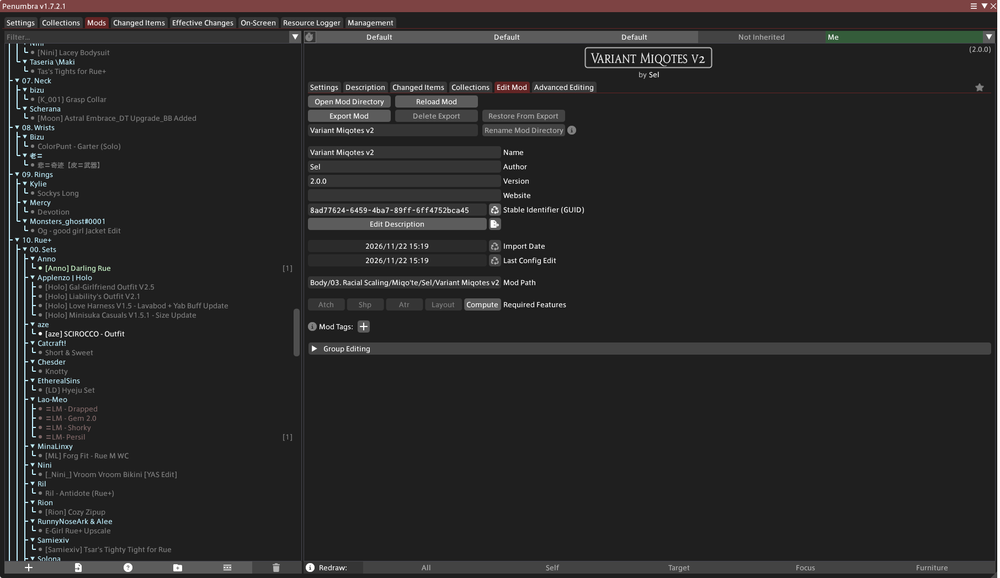

*Numbered gear folders: the shared slot folders (`07. Neck`, `08. Wrists`, `09. Rings`), then the
first body, `10. Rue+`, with its own `00. Sets` and a folder per creator. On the right, a racial
scaling mod filed at `Body/03. Racial Scaling/Miqo'te/Sel/Variant Miqotes v2`: race, then creator.*

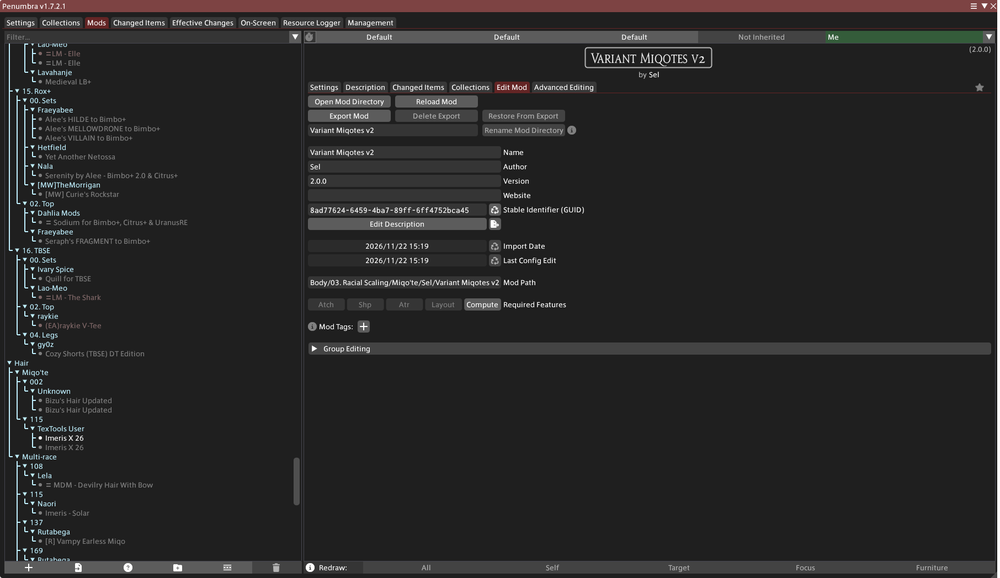

*Further down: more bodies (`15. Rox+`, `16. TBSE`) with only the slot folders they have mods for.
Hair is split by race and then by hair number (`Hair/Miqo'te/115/...`), and hair made for several
races sits under `Hair/Multi-race/<number>`.*

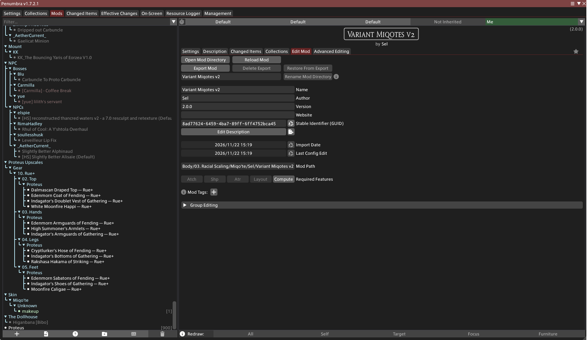

*NPC mods split by kind (`NPC/Bosses`, `NPC/NPCs`). With Proteus on **Sort inside their folder**, its
mods stay under `Proteus Upscales` and are sorted beneath it (`Proteus Upscales/Gear/10. Rue+/02. Top/...`).
The Proteus managed mod, `Proteus`, is at the root, where **Place the Proteus managed mod at the root**
puts it.*

*A folder kept as the top level with Protect > Sort inside folders: the mods in `Akako` are sorted
beneath it with the same layout as everything else (`Akako/Face/Eyes/Miqo'te/...`,
`Akako/Gear/10. Rue+/03. Hands/...`). Below it, `Animation and VFX` with `Animation`,
`Battle Animation` and `Emotes`.*

#### Manual assignment

A collapsed section at the bottom of the tab, on both screens, assigns a folder to specific mods. Its
own **Search mods** box filters the list below it, the same way the Protect tab's does. Each row shows
the mod's name and current path. Check the mods you want (protected mods never appear here), type a
**Destination folder**, and click **Assign N selected mods**. Each checked mod's proposed path becomes
`{destination}/{ModName}`. Unlike Sort, this does not renumber name clashes: two mods with the same name
in the same folder show as a path collision on Review Changes.

A summary line reports how many were assigned and how many were skipped, for example because a mod
stopped being eligible after you checked it, or because you left the folder box empty. Your checked
selection survives changes to the search box, so you can filter down, check some mods, clear the
filter, and check more without losing what you already picked.

### Review Changes

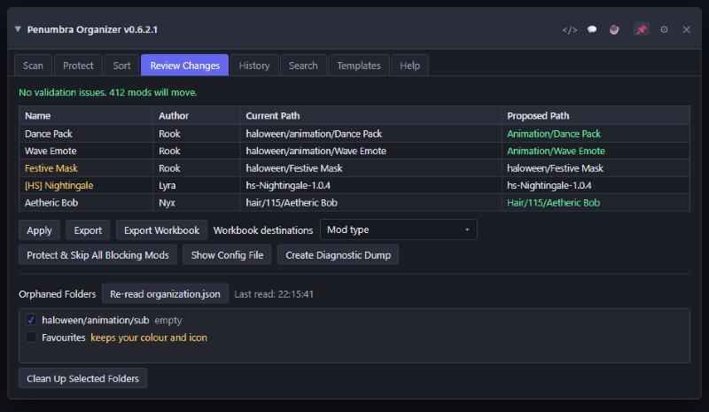

The gate between a proposal and your actual library. Everything above this tab is reversible by
doing nothing; this is where you commit.

#### The validation line and the table

The top line is the result of `Validate()`. Any **protected-mod-changed** or **path-collision**
errors are listed in red, and Apply stays disabled while any exist. The table below shows every
mod's current path beside its proposed path, so you can read the whole change before committing.

- A **protected mod changed** error means something assigned a proposed path to a mod you
  protected. It is a bug-catcher: protection is supposed to make that impossible.
- A **path collision** means two mods would end up at the same path. Penumbra would reject or
  mangle one of them, so the plugin refuses first.

**Protect & Skip All Blocking Mods** is the one-click fix: every mod currently blocking Apply —
whether protected-but-changed or on the losing side of a collision — has its proposed path reset to
its current path and gets protected. Apply becomes available without you tracking down each one.

#### Apply

Apply is disabled while any validation issue exists. When you click it, a confirmation popup shows
how many mods will move; confirming calls Penumbra's `SetModPath` for every mod whose proposed path
differs from its current path.

The result shows a succeeded and failed count, with Penumbra's own error code as the reason for
each failure, for example `PathRenameFailed`. When some mods failed, a **Show failed mods** button
beside that line opens a small window naming each mod that could not be moved, the reason Penumbra
gave, and the path it was being moved to. Apply also captures a snapshot of your library just
before it runs, so you can always get back to where you started — see History below.

#### Workbook

A **Workbook** group above Apply holds everything for the Excel round trip:

- **Export mode** decides what goes in the workbook's Destination column. **As is** writes each mod's
  current folder, which is what you want when you intend to write the layout yourself. **As suggested
  by Sort** writes the folders the last Sort staged, including every Sort setting (splits, numbered
  folders, race folders); it is greyed out until you press Sort, and again whenever your Sort settings
  change or you stage paths another way (a template, a manual move, a protection change, an import).
  Protected mods always get a blank Destination, which means "leave this one alone" on import, and so
  do top-level mods in As is.
- **Export Workbook** writes `organizer-workbook.xlsx` for this library. **Open Workbook** opens the
  file you just wrote. The file belongs to your library: a workbook from another Penumbra library is
  refused.
- **Import Workbook** opens a file picker for an `.xlsx` exported from this plugin and applies its
  per-mod destination folders as proposed paths. Use it instead of the built-in groupings when you
  want to hand-edit an assignment list in Excel first. It works with a scan loaded and nothing
  staged, and stays greyed while a scan runs. A summary line, plus any errors or warnings, appears
  below the buttons once the import finishes; it counts moves ready for review, unchanged rows, rows
  skipped as stale and rows blocked by errors separately, and lists how many mods used each custom
  category. A cell you did not touch comes back exactly as exported.

##### Your own categories and tokens

The **Category Mapping** sheet lists the sixteen built-in codes (1 to 16) under a red banner: do not
edit them, edits are ignored with a warning. Under them, add your own rows from **17** up: a number in
the `code` column and a folder in the `folder` column, for example `17` and `Face/Sculpts`. Then type
`17` in a mod's Destination instead of the whole path, and `17/Thor` becomes `Face/Sculpts/Thor`. At
most 200 custom rows. A code used twice, a folder with `..` in it, an unknown token, or a formula in
these cells is an error that names the cell, and only the mods that use that code are held back. After
an import with a clean mapping table the plugin remembers your rows and writes them into the next
export, so a re-export does not lose them.

A destination (or a mapping folder) may use three tokens, in any segment: `{type}` is the mod's
category folder (`Hair`, `Animation and VFX`, or `Review` for an unclassified mod; your own folder if
you renamed the category in the Sort tab), `{creator}` is the
creator folder the Sort tab uses, and `{race}` is the race folder (`Viera`, `Multi-race`, and so on)
for a mod that has one. For example `Mine/{type}/{creator}/test` becomes `Mine/Hair/Thor/test`. A
token with nothing to fill in drops its folder level: a mod with no creator gets `Mine/Hair/test`.
Text around a token stays, so `By-{creator}` becomes `By-` for a mod with no creator. Tokens work in
new-format workbooks only.

In the new format the built-in folders follow the Sort tab: code 13 is `Animation and VFX/VFX`, 15 is
`Animation and VFX` and 16 is `Review`. If you renamed a category's folder in the Sort tab's Advanced
screen (Gear as `Equipment/Gear`, say), its code and `{type}` use your folder instead. A workbook
exported before such a rename says so on import ("code N now files under X (exported as Y)") rather
than calling the code edited. Older workbooks still import, with their old meaning for codes 13, 15
and 16 and no tokens. The standalone app cannot read the new format.

**Apply** sits below the group, in the plugin's purple, set apart from the rest.

#### Diagnostics

A collapsed section, closed by default:

- **Export** writes every mod's full field set plus the validation result to a plain-text file
  (`organizer-export.txt`, overwritten each time). Each mod lists its detected body type and the
  evidence behind it, and whether a tool manages it (`ManagedBy:`). If any of your mods are Gear, it
  adds the one-line slot-resolution summary described under Sort. It is a snapshot to read, not
  something to re-import.
- **Show Config File** opens Explorer with the plugin's own settings file (your protected mods, folder
  rules and Sort choices) selected, so you can copy or attach it.
- **Failed mods** opens the same window as the button beside the Apply result, for the most
  recently finished Apply or Restore.
- **Create Diagnostic Dump** writes a plain-text state summary - mod and protection counts (including
  Heliosphere- and Proteus-managed ones), the last Apply/Restore/Folder Cleanup result including one
  from a previous session, and the session's event log - to `organizer-diagnostics.txt`, and **Show
  Dump File** opens Explorer with it selected. Attach that file when reporting a problem.

#### Orphaned Folders

Below a separator, this section appears once you have scanned at least once. It finds folder entries
left behind in Penumbra's own `organization.json` after a mod moved out of them.

**Re-read organization.json**, with a "Last read" timestamp beside it, re-reads the file from disk.
It does **not** ask Penumbra to refresh its own live folder tree, which is why the count can look
wrong right after a big Sort or Restore. If it does, move one folder in Penumbra's own UI (or click
its Rediscover Mods) and re-read.

Plain empty folders are pre-checked. Folders that still carry your own customization — an icon,
colour, or name override — are shown unchecked for you to review before pruning, because deleting
one throws that customization away.

**Clean Up Selected Folders** removes the checked entries, with its own backup and **Rollback
Folder Cleanup** pair, separate from Apply's history. Afterwards a banner reminds you to click
Rediscover Mods in Penumbra's settings, since this plugin has no IPC call that can trigger that
reload itself.

### History

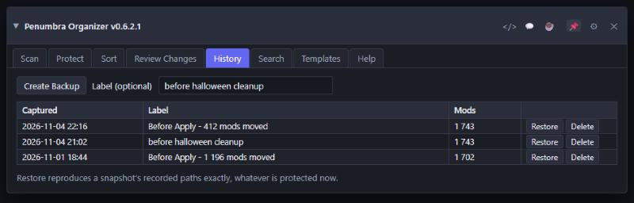

The undo for everything this plugin does to your library.

#### What gets captured

Every Apply and every Restore automatically captures a snapshot just before it runs, so both are
undoable. You can also click **Create Backup** at any time, with an optional label, to save one on
demand — worth doing before a big reorganisation you are unsure about.

Each entry shows when it was captured, its label or an auto-generated description such as "1723
mods moved", and how many mods it covers. History persists across game restarts.

#### Restoring

Clicking **Restore** opens a confirmation with an exact preview:

- how many mods will move to their snapshot path;
- how many are already at it;
- how many, installed since the snapshot was taken, will be moved to the Penumbra root;
- how many, uninstalled since, will be skipped.

If any mods in that preview are currently protected or Heliosphere-managed, a warning line tells you
how many will move anyway.

That is deliberate: **Restore ignores protection.** A snapshot is a record of where your mods were,
and current sort protection should not be able to stop you getting back to it. Only two things stop
a mod being restored — it is no longer installed (reported as skipped), or Penumbra's `SetModPath`
rejects the move (reported as failed, with Penumbra's error code).

Confirming a Restore captures its own pre-restore snapshot first, so a restore is itself undoable.

#### Delete

Removes a snapshot from the list. Restoring to any other snapshot still works normally afterwards.
Deleting a snapshot does not touch your mods.

### Search

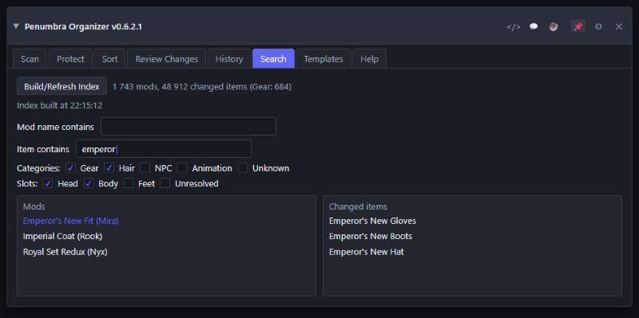

A read-only reverse lookup: find every installed mod, enabled or not, by the game items it changes.
It is independent of the Sort tab, builds its own index, and never moves, protects, or modifies
anything.

#### Build/Refresh Index

Scans your installed mods and their changed-items sets into a searchable index. This is **separate
from the Scan tab's scan**, so click it once here before searching, and again after installing or
removing mods. A summary line reports what was indexed — mod count, total changed items, and a
gear-slot breakdown — with the build time beneath it.

Like the Scan tab's scan, it runs in the background with a progress line and a Cancel button, and
is discarded if your mod list changes while it is running.

#### Narrowing the results

- **Mod name contains** matches the mod's name.
- **Item contains** matches the names of the items it changes.
- **Categories** filters by mod category, with an Unknown toggle for mods that did not classify.
- **Slots** appears when Gear is among the selected categories, filtering Gear mods by equipment
  slot, plus an Unresolved toggle for Gear mods whose slot could not be determined.

#### Reading the results

The left pane lists matching mods as `Name (Author)`; click one to select it. The right pane lists
that mod's changed items.

If a mod matched only because of the **Mod name contains** box and not because of any item, a red
"Matched by mod name, not by item" note appears above its item list. That distinction matters when
you are hunting for which mod touches an item: a name hit is a coincidence of naming, an item hit is
the real answer.

### Templates

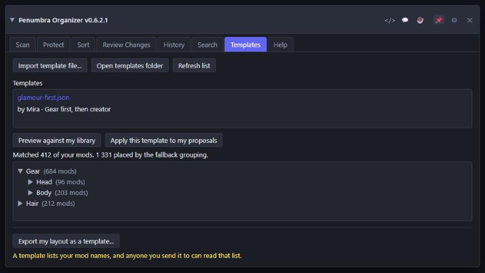

A template is an organization layout someone else shared as a `.json` file. Importing one proposes
where your mods would go: mods you and the template's author both have land in the folder they
chose, and everything else is placed by the fallback sort strategy they picked, using their folder
names.

#### Using someone else's template

1. Get a template file from whoever shared it and click **Import template file...**, or drop the
   file into the templates folder yourself (**Open templates folder** shows you where) and click
   **Refresh list**.
2. Select it in the list to see who made it and what it is for.
3. Click **Preview against my library**. You get a count of how many of your mods the template
   matched, how many its fallback strategy placed, and a browsable tree of the resulting folders
   with the number of mods in each.
4. If it looks right, click **Apply this template to my proposals**, then open **Review Changes**
   to check the result and apply it like any other sort.

Nothing is written to Penumbra until you apply from Review Changes, exactly as when you sort from
the Sort tab.

A few things worth knowing:

- **A template never sees your mod list.** It matches on mod names, so it only affects mods you
  already have. Mods its author never had are placed by the fallback strategy, not left behind.
- **Matching is on the mod's name**, ignoring case, install suffixes like `_1_1_0`, and bracketed
  tags. A mod you renamed will not match, and will be placed by the fallback strategy instead.
- **Protected mods are never moved**, the same as with any sort. Heliosphere and Proteus mods follow
  the mode you chose on the Protect tab: under Sort inside their folder, a template still keeps
  them beneath their tool's folder, and the Proteus managed mod still goes to the root if you asked
  for that.
- **The fallback's hair and body splits use your settings.** If the template's author ticked a hair
  or body split, it turns that split on for the mods the template does not mention, but which hair
  race and which body order applies is your own Sort tab setting. A template made before these
  options existed has them off and behaves exactly as it always did.
- If you rescan your library after previewing, the preview is discarded — preview again before
  applying.

#### Sharing your own layout

**Export my layout as a template...** builds a template from your library.

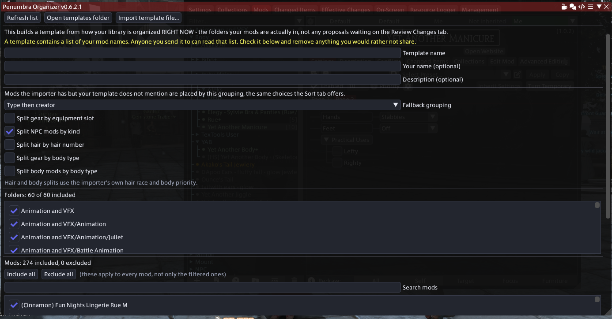

Read this part before you use it: **a template contains a list of your mod names, and anyone you
send it to can read that list.** That is the whole point of the format — it is how an importer knows
which of their mods you have an opinion about — but it means exporting is publishing. If any of your
mods are things you would not want a stranger, or a friend, reading off a list, take them out first.

That is what the review screen is for, and there is no way to export without going through it:

1. Click **Export my layout as a template...**. The screen opens with **everything included**, so
   what you see is your actual library.
2. Give it a name, and optionally your name and a description.
3. Pick the **fallback grouping** — where an importer's mods go when your template says nothing
   about them. These are the same choices the Sort tab offers, including the gear, NPC, hair and
   body-type splits. Your choices here are remembered for next time.
4. Go through the folder and mod lists and untick anything you would rather not share. Unticking a
   folder also unticks the mods in it. The search box narrows what you are looking at; **Include
   all** and **Exclude all** always apply to every mod, not only the ones showing.
5. Then either **Save to templates folder**, which writes a `.json` you can send to anyone, or
   **Copy share code**, which puts the whole template on your clipboard as one line of text.

Some things worth knowing:

- **Export uses where your mods are now**, not any proposals sitting on Review Changes. If you have
  sorted but not applied, the template describes your *old* layout, because that is the one your
  library actually has. The screen says so.
- **Saving closes the creator** and reports "Saved as ..." on the list screen.
- **Share codes only work for small templates.** A chat message holds about 2000 characters, which
  is roughly a hundred mods. Past that the button is disabled and the screen tells you the length —
  send the file instead.
- **Mods sitting loose at the top level are left out.** A template only carries folders, so a mod
  that is not in one has nothing to record. The screen tells you how many.
- If two of your mods have names that match once suffixes and tags are stripped, and they are in
  *different* folders, that name is left out and the screen says so — a template cannot say two
  things about one name. Exclude one of them to include the other.

### Help

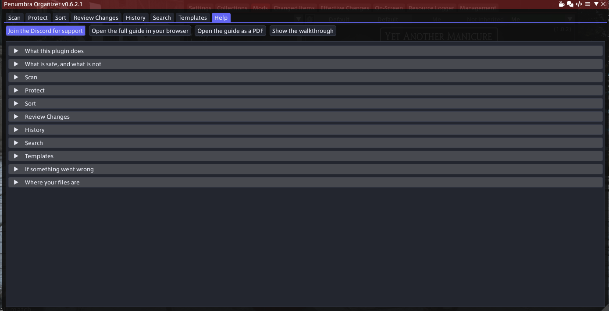

Every explanation the plugin holds, at reading length rather than tooltip length. It is grouped into
collapsible sections: what the plugin does, what is and isn't safe, one section per tab, what to do
if an operation was interrupted, and where your files live.

Each tab's section lists that tab's controls with the same one-line explanation you get by hovering
them, so the Help tab doubles as a reference for anything you saw a tooltip on and want to find
again.

#### The four buttons

"Join the Discord for support" opens the project's Discord in your browser. That is the fastest
place to get help, and where releases and testing builds are announced.

"Open the full guide in your browser" opens this document, pinned to the release you're running
rather than to the latest one, so it always describes the version you actually have.

"Open the guide as a PDF" opens the same guide as a PDF, pinned the same way. It is generated from
this document, so the two cannot describe different versions.

"Show the walkthrough" reopens the guided first run, the eight-step tour shown the first time you
open the plugin. While it runs, the plugin window behind it switches to the tab each step describes and
outlines the button to press (Refresh mod list, Sort, Apply). It can be reopened as often as you like.

If you upgraded to 0.6.0 from an earlier version, that walkthrough runs once for you too. That is
deliberate rather than a mistake: 0.6.0 replaced the whole Sort control, changed how NPC names are
matched, and added this tab, so there is as much new for an existing user as for a new one. Dismiss
it and it will not return.

Nothing on this tab changes anything - it reads no mods and writes no files.

## Hair

Hair mods that ship one folder per race can be filed under the hair number most races use. All
three controls (the Hair number split, Priority race and Midlander fallback) are under Hair in the
Sort tab's Advanced screen and are described under [Sort](#sort) above. Both extra controls show only
while Hair number is on, and all three are remembered between sessions.

Read the caveat at the bottom of this page before trusting the numbers on a library you care about.

## Body type

Gear can be put in folders named after the body it was made for, so everything that fits one body
sits together. That is worth having when you change body and need to know what still works. The
controls are the **Body type** split of Gear and the **Part and body type** split of Body, in the
Sort tab's Advanced screen, described under [Sort](#sort) above.

The body comes from the mod's options and files first, then its name, then the library folders
above it. Only gear in the Top, Hands, Legs and Feet slots is looked at, so weapons, hats and jewellery never
get a body folder.

### Body priority

In the Body types panel under Gear and Body (Sort tab, Advanced) is a collapsed **Body priority** section. When a mod
supports more than one body, it is filed under the highest-ranked one. Use the up and down arrows to
reorder, or **Reset to default**. A **First-choice body** dropdown moves one body straight to rank 1.

*Advanced with Body selected: three splits with their depth numbers, the example path, the Race panel,
and the Body types card with First-choice body, Check my collection and the full priority order
(Rue+, Bibo+, Neolithe, YAB, ...).*

The order is saved between sessions, and so are the hair priority race, the Midlander fallback,
Group by and the category layouts. The order is applied when you press Sort, so reordering and
sorting again re-files mods without a rescan.

To add bodies the plugin does not know, create `body-type-list.json` in the configuration folder;
see [Where files live](#where-files-live). Read the caveat at the bottom of this page first.

## Sort rules

The layouts on the Sort tab decide where every kind of mod goes. Sort rules are for the exceptions: a
creator whose mods you want together, a set of mods you always keep in one place, everything whose name
says "recolor". You write them in the **Rules** card on the Sort tab's Advanced screen.

### What a rule is

A rule is one line of text: a condition, an arrow `->`, and a folder.

    name contains 'hrothgar' and type = 'Body' -> Body/Hrothgar/{creator}

It reads: if a mod's name contains "hrothgar" and it is a Body mod, file it in
`Body/Hrothgar/<its creator>`. The part before the arrow is the **condition**; the part after it is
the **folder**. The mod's own name is always added at the end, so a body mod named "Strong Build" by Ann
goes to `Body/Hrothgar/Ann/Strong Build`.

To add one, open **Rules** in Advanced, press **Add rule** and type into the new line.

### How rules are applied

- **Top to bottom, first match wins.** For each mod, the rules are checked from the top of the list,
  and the first rule that is switched on, has no mistake, and matches, files the mod. The rules below it
  are not looked at for that mod. So **the order is the priority**: put the narrow rules above the broad
  ones, and use **Up** and **Dn** to move them.
- **A rule replaces the whole path.** The folder you write is the path, plus the mod's name. The Sort's
  own layout (type folder, creator folder, numbered gear and body folders, body type, race, hair number,
  emote folders) does not apply to a mod a rule has filed, and such a mod takes no number in the
  numbered folders.
- **Everything else sorts as usual.** A mod that no rule matches gets the normal layout.
- **Protected mods are never touched**, by rules or anything else in a Sort. So is the Proteus managed
  mod while **Place the Proteus managed mod at the root** is on.
- **Rules apply to every Sort**: the Sort button on either screen (Recommended included), What to sort
  set to loose mods only (rules then apply to those mods only), and the automatic sort of new mods from
  the popup or Sort automatically. They do **not** apply to a template's fallback sort, nor to Manual
  assignment or a workbook import.
- **Off without deleting.** Untick a rule to switch it off. It stays in the list and files nothing.
- **Saved when you leave the box.** Typed text is saved when the text box loses focus (or when you
  switch to Recommended). Adding, removing, moving or ticking a rule saves at once. Rules are kept
  between sessions.
- **Limits:** 100 rules (at 100, Add rule is greyed and says "100 rules is the limit."), each at most 300
  characters.
- **Sort again after a change.** Editing a rule moves nothing by itself. Press Sort, then check Review
  Changes and Apply as usual.

### The condition: SQL-like, but not SQL

If you have written a SQL query, the condition will look familiar: it follows the `WHERE` part of one.
It is deliberately small, though, and you cannot paste a SQL query in.

#### Fields

Every field is text. A value the plugin does not know is empty text, never "nothing".

| Field | What it holds |
| --- | --- |
| `name` | The mod's name, as Penumbra shows it. |
| `author` | The creator, as the Sort tab names its creator folder. Empty when the mod has no author. |
| `folder` | The folder the mod is in now, without the mod's own name, for example `Gear/10. Rue+/02. Top/Ann`. Empty for a mod loose in the root. |
| `type` | The category's built-in folder name (see below). Renaming a category's folder in Advanced does not change it. |
| `subtype` | The slot or kind inside a category (see below). Often empty. |
| `race` | What `{race}` gives: one race, or `Multi-race`. Empty for mods that have no race (gear, weapons, body replacers, and so on). |
| `body` | The body type, such as `Bibo+` or `Rue+`. For Gear with the Body type split on, and Body with Part and body type on, it is the body your Body priority picks; otherwise the one the scan found. Empty when there is none. |

**Values of `type`:** `Gear`, `Weapon`, `Face`, `Hair`, `Body`, `Skin`, `NPC`, `Minion`, `Mount`, `Pet`,
`Ornament`, `Furniture`, `Sound`, `Animation and VFX` (animation and VFX mods share it) and `Review`
(the Others category and any mod that could not be classified). A weapon-only mod is `Weapon` only when
it was scanned with Weapon's Job split on; otherwise it is `Gear`.

**Values of `subtype`:**

- Gear: the equipment slot when there is exactly one: `Head`, `Top`, `Hands`, `Legs`, `Feet`, `Ears`,
  `Neck`, `Wrists` or `Rings`. Empty for a multi-piece outfit or when the slot is unknown.
- NPC: `NPCs`, `Bosses` or `Enemies`.
- Hair: the hair number when the mod uses exactly one, written without leading zeros (`115`, `2`, not
  `002`).
- Animation and VFX: `Emotes`, `Battle Animation`, `Animation` or `Other` for animation mods, and `VFX`
  for VFX mods.
- Everything else: empty.

**Values of `race`:** `Midlander`, `Highlander`, `Elezen`, `Miqo'te`, `Roegadyn`, `Lalafell`, `Au Ra`,
`Hrothgar`, `Viera` or `Multi-race`. Only hair, face (including eyes), skin, tails, ears and horns, and
racial scaling mods have one. It follows the Race panel's **Send multi-race mods to Multi-race** box and
**Race priority** (a mod for several races is `Multi-race` while the box is ticked, otherwise the
highest-ranked race it covers), and a mod whose race could not be found is `Multi-race`. It does not
depend on the **Split by race** switch or on the race splits being on.

#### Operators

| Operator | Matches when the field... | Example |
| --- | --- | --- |
| `=` | is exactly the text | `type = 'Hair'` |
| `!=` | is not exactly the text | `author != 'Ann'` |
| `contains` | contains the text anywhere | `name contains 'recolor'` |
| `starts with` | begins with the text | `folder starts with 'Downloads'` |
| `ends with` | ends with the text | `name ends with 'v2'` |
| `in (...)` | is exactly one of the texts in the list | `subtype in ('Top', 'Legs')` |

Every operator can be negated by writing `not` just before it: `name not contains 'nsfw'`,
`type not in ('Gear', 'Hair')`, `folder not starts with 'Old'`, `author not = 'Ann'` (the same as `!=`).

#### Combining tests

Join tests with `and` and `or`, negate a whole test with `not` in front of it, and use brackets to group:

    (author = 'Ann' or author = 'Bea') and not type = 'Gear' -> Friends/{type}

Without brackets, `not` binds tightest, then `and`, then `or`, exactly as in SQL. So
`author = 'Ann' or author = 'Bea' and type = 'Gear'` means "anything by Ann, or gear by Bea", and
`not type = 'Gear' or name contains 'x'` means "(not gear) or (name contains x)". When in doubt, add
brackets.

#### Same as SQL

- Text goes in **single quotes**: `'abc'`. To put a quote inside the text, write it twice:
  `author = 'O''Brien'`, `race = 'Miqo''te'`.
- Keywords and field names are not case sensitive: `NAME CONTAINS 'x'` and `name contains 'x'` are the
  same rule.
- `not` binds tightest, then `and`, then `or`, and brackets override that.

#### Different from SQL

- **Text comparison ignores capitals**: `'hrothgar'` matches `Hrothgar`. (Accents are not ignored.)
- **No wildcards.** Use `contains`, `starts with` and `ends with` instead of `LIKE '%x%'`; `%` and `_`
  are ordinary characters.
- **No NULL.** A missing author, race, subtype or body is empty text, so write `race = ''`, not
  `race IS NULL`.
- **Only straight single quotes.** Double quotes and curly quotes are an error ("Use straight single
  quotes: 'abc'."), which matters when you paste a rule from a chat or a document.
- **Not there:** `<>` (write `!=`), `LIKE`, `BETWEEN`, `IS`, numbers, `<` and `>`, functions,
  `ORDER BY`, subqueries and comments. Every value is quoted text, a hair number included
  (`subtype = '115'`).

#### Empty text

`= ''`, `!= ''` and `in ('')` are allowed and are how you test for a missing value:
`author = ''` matches mods with no author, `race != ''` matches mods that have a race.
`contains ''`, `starts with ''` and `ends with ''` are rejected ("'contains' needs some text; an empty
value would match everything."), because every text contains the empty text.

### The folder

Everything after the arrow is the folder, written as a Penumbra path with `/` between levels (a `\` is
read as `/`, and spaces around each level are trimmed). Quotes are not needed here: `-> Ann's mods` is
fine. The mod's name is added at the end.

The folder may use three tokens, in any level, written in braces (their names are not case sensitive):

| Token | Becomes |
| --- | --- |
| `{type}` | The category's folder as the Sort uses it: `Gear`, `Animation and VFX`, `Review` and so on, or your own folder when you renamed the category in Advanced (`Equipment/Gear`). Unlike the `type` field, it follows the rename. |
| `{creator}` | The creator folder the Sort tab would use. Empty when the mod has no author. |
| `{race}` | The same value as the `race` field. Empty for mods with no race. |

**An empty token drops its level.** If a level consists only of tokens and they all come out empty,
that level disappears: `Skins/{race}/{creator}` gives `Skins/Miqo'te` for a Miqo'te skin with no
author. Text around a token stays, so `By-{creator}` gives `By-` for a mod with no author.

**When the folder cannot be built**, the mod is left where it is, and the scope line in the pinned bar
says so after the Sort, for example "1 left in place by rules: Rule 3 for "Glow Skin": Folder expands to
nothing for this mod.". That happens when every level comes out empty, when the folder uses an unknown
token such as `{author}` ("unknown token {author}"), has a stray `{` or `}` ("Folder has an unmatched {
or }."), or is not a valid relative path (a drive letter or `:`, a `.` or `..` level, or more than 260
characters). The rules list does not flag these while you type, because they depend on the mod, so
check the scope line after sorting. The same messages appear in the Review tab's Diagnostics export
(`RulesUnplaced:`), which also names the rule that filed each mod (`StagedRule:`).

### Examples

The mods in these examples: "Medieval Dress", a Bibo+ top by Ann; "Imeris - Solar", a Viera hair by
Bizu; "Glow Skin", a Miqo'te skin with no author; "Akako 4.0a dt", a Miqo'te face by Akako Ai;
"Gaelicat Minion", a minion loose in the root with no author. Group by is Type then creator on the
Recommended layout, so without rules "Medieval Dress" would go to
`Gear/10. Bibo+/02. Top/Ann/Medieval Dress`.

1. **One creator in one folder.**

        author = 'Ann' -> Ann's mods

   "Medieval Dress" goes to `Ann's mods/Medieval Dress`, and so does every other mod by Ann, whatever
   its type.

2. **Two slots together, still by creator.**

        type = 'Gear' and subtype in ('Top', 'Legs') -> Gear/Outfits/{creator}

   "Medieval Dress" goes to `Gear/Outfits/Ann/Medieval Dress`, with no body or slot folder. A
   multi-piece outfit has an empty subtype, so it is not matched and sorts as usual.

3. **One race's hair, without hair numbers.**

        type = 'Hair' and race = 'Viera' -> Hair/Viera/{creator}

   "Imeris - Solar" goes to `Hair/Viera/Bizu/Imeris - Solar`. A hair made for Viera and Au Ra is
   `Multi-race` while Send multi-race mods to Multi-race is ticked, so this rule does not take it.

4. **Either word, kept by type.**

        name contains 'recolor' or name contains 'retexture' -> Recolors/{type}

   A gear mod named "Medieval Dress Recolor" goes to `Recolors/Gear/Medieval Dress Recolor`. If you
   renamed Gear to `Equipment/Gear` in Advanced, it goes to `Recolors/Equipment/Gear/Medieval Dress
   Recolor`, while the condition would still have to say `type = 'Gear'`.

5. **An empty token collapses.**

        type = 'Skin' -> Skins/{race}/{creator}

   "Glow Skin" goes to `Skins/Miqo'te/Glow Skin`: it has no author, so the `{creator}` level drops out.
   A Miqo'te skin by Ann would go to `Skins/Miqo'te/Ann/<name>`.

6. **A quote inside the text, and brackets.**

        race = 'Miqo''te' and (type = 'Face' or type = 'Hair') -> Miqo'te/{type}

   "Akako 4.0a dt" goes to `Miqo'te/Face/Akako 4.0a dt`. The quote is doubled inside the condition's
   text but written once in the folder. Without the brackets the rule would also take every hair mod of
   any race, because `and` binds before `or`.

7. **Mods with no author.**

        author = '' -> No author/{type}

   "Gaelicat Minion" goes to `No author/Minion/Gaelicat Minion`. Writing `-> {creator}` instead would
   come out empty for every mod this rule matches, so they would all be left where they are.

8. **Excluding with not.**

        not type in ('Gear', 'Hair') and name starts with 'a' -> A/{type}

   This reads "(type is not Gear or Hair) and (name starts with a)". "Akako 4.0a dt" goes to
   `A/Face/Akako 4.0a dt`; a gear mod named "Apron" is not matched.

9. **A folder test that stays true.**

        folder = 'Downloads' -> Inbox

   files every mod sitting directly in `Downloads` under `Inbox`, but shows the amber warning: once a
   mod is in `Inbox`, its folder is no longer `Downloads`, so the next Sort no longer matches it and
   sorts it as usual. Written as `folder in ('Downloads', 'Inbox') -> Inbox`, the rule keeps matching
   the mods it has already filed, and the warning goes away.

The order matters when rules overlap. With rule 1 above first and rule 2 second, "Medieval Dress" goes
to `Ann's mods`; swap them with Up and Dn and it goes to `Gear/Outfits/Ann`.

### What the rules list tells you

Under each rule, a status line updates as you type:

- **A red message** when the rule has a mistake, with the position of the problem in brackets, counted
  in characters from 0 at the start of the line. For a misspelt field or operator it suggests the
  closest one: "Unknown field 'nmae'. Did you mean 'name'? (at 0)", "Unknown operator 'contians'. Did
  you mean 'contains'? (at 5)". Other messages include "Missing '->' and a folder.", "Expected a quoted
  text like 'abc'.", "Text starting here is not closed; add a closing '.", "Expected 'with' after
  'starts'." and, for a new empty line, "Rule is empty.". A rule with a mistake files nothing; when you
  Sort with it switched on, the scope line says "Skipped Rule 2: ..." so it is not silently ignored.
- **"Wins for N mods"**, a moment after you stop typing, for a good rule. It counts the mods this rule
  would file: protected mods are left out, and so are mods an earlier rule already wins, so the numbers
  of all the rules add up. It is recounted after a scan and when the race or body settings change.
  "Counting..." shows while it waits, and "Off" for a rule you switched off (a switched-off rule with
  a mistake still shows the red message).
- **An amber warning** when the rule tests `folder`, its folder has no tokens, and that folder would
  not pass the rule's own condition ("This rule's folder no longer matches its own folder condition, so
  the next Sort may file the mod somewhere else."), as in example 9. The check tries the folder with
  every other field empty, so a rule that also tests, say, `type` can warn even though it would keep
  matching; read it as a prompt to check the rule.
- **A second amber warning** when the rule's folder is inside a protected folder ("This rule's folder
  is inside a protected folder, so mods filed there will be treated as protected."). Mods it files
  there can then not be moved by a later Sort until you unprotect the folder.

### Rules and the rest of the plugin

**Recommended.** Rules are edited only in Advanced, but they apply whichever screen you sort from.
While at least one rule is switched on and free of mistakes, the Recommended card says "N rules active,
edit them in Advanced", and **Show rules** opens Advanced with the Rules card open and scrolled into
view. The example paths on Recommended do not show rules.

**The workbook's "As suggested by Sort".** That export mode on Review Changes writes the folders the
last Sort staged, rule results included. Editing a rule's text, reordering, switching a rule on or off,
adding or deleting one (even a switched-off or broken one) greys it out until you press Sort again, so
the workbook never describes rules that are not the ones you have now. For a rule that uses `race` or
`{race}`, changing the race settings does the same.

**Sort inside folders, and Heliosphere and Proteus in Sort inside mode.** A mod kept under such a folder
stays under it when a rule files it: the rule's folder is placed beneath that folder. If the rule's
folder already starts with it, it is not added twice. With `.Chars/Alice` as a sort-inside folder and a
mod "Alice Nails" in it:

- `name contains 'nails' -> Nails` gives `.Chars/Alice/Nails/Alice Nails`;
- `name contains 'nails' -> .Chars/Alice/Nails` gives the same path, not
  `.Chars/Alice/.Chars/Alice/Nails/...`.

The mods in that folder no rule matches are sorted beneath it as usual. To leave everything in the folder
exactly where it is, rules included, protect the folder on the Protect tab instead.

**Protection.** A protected mod is never matched or counted. A rule cannot unprotect anything.

## Typical workflows

First-time sort: Scan, choose a grouping on the Sort tab (Recommended is a good start) and press
Sort, review the proposed paths on Review Changes, then Apply.

New mods installed while the game runs: answer the new-mod popup with Sort now, check the list in
Confirm sort, then Apply. Or set Sort > Auto sort to Sort automatically.

New mods installed since the last sort, outside the game: Scan again (this picks up the new mods;
previously-set protection carries over), set What to sort to Only loose mods in the root if you only
want the new ones filed, press Sort again, review, then Apply.

Changing one kind of mod's layout: on the Sort tab, switch to Advanced, pick the category, change its
folder, creator folder or splits, watch the Example, then Sort, review and Apply.

Filing particular mods yourself: in Advanced, open Rules, Add rule, write `condition -> folder`, wait
for "Wins for N mods", then Sort, review and Apply. See [Sort rules](#sort-rules).

Hand-tuning through Excel: on Review Changes, Export Workbook, edit destinations in Excel, then on
the same tab Import Workbook, review again, then Apply.

Protecting a folder but letting one subfolder sort: on the Protect tab, click the parent folder's
box until it shows a solid `[x]`, open it, then click the subfolder's box twice - once to give it
its own rule, once more to make it `[-]`. Sort, and only that subfolder's mods are proposed for
moving. If some mods in there are still protected by their own tick or by Heliosphere, use Unprotect
N inside on that subfolder to clear those too.

Undoing an Apply, or going back further: open the History tab and Restore the snapshot from just
before the Apply (or any earlier one). Protection doesn't block this, so it works even for mods
you've since protected.

After moving mods around inside Penumbra directly: Scan, check the Orphaned Folders section on
Review Changes, Clean Up Selected Folders, click Rediscover Mods in Penumbra, then Scan again to
confirm.

Finding which mod changes a given item: open the Search tab, Build/Refresh Index, type part of the
item name into "Item contains", then click a matching mod to see its full changed-items list.

## Where files live

Everything the plugin writes lives under Dalamud's per-plugin config directory:
`organizer-history.json` for rollback snapshots (Apply, Restore, and manual backups all share this
one multi-snapshot history), `organizer-folder-backup.json` for Folder Cleanup's own separate
rollback data, `organizer-export.txt` for the plain-text Review export, `organizer-diagnostics.txt`
for the diagnostic dump, `organizer-workbook.xlsx` for the last exported workbook, an `operations`
folder holding one record per Apply or Restore (the Failed mods window reads the newest), and
`npc-name-list.json` for the NPC/enemy/boss name list, which is seeded on first run and updated in
place by Refresh. The plugin also READS `body-type-list.json` from the same directory if you
create one, to add bodies the shipped list does not know or correct one it does; it is never created
or written by the plugin, and is simply ignored when absent. Your protected mods and protected folders,
the Sort tab's settings (category layouts, race and body priority, rules, Auto sort) and the Protect
tab's tool modes live in the plugin's own Dalamud settings file (reachable via Show Config File on the Review Changes tab), not in this directory.
The plugin never writes inside Penumbra's own mod storage, with one exception covered in
[TECHNICAL_SPEC.md](TECHNICAL_SPEC.md): Folder Cleanup's edits to `organization.json`.

## Known caveats

See [ROADMAP.md](ROADMAP.md) for the current status. The child-race-variant NPC classification fix
is implemented but not yet confirmed against a real, in-game mod library. The NPC wiki-refresh path
has no automated test coverage. Folder Cleanup detection can appear stale immediately after a large
Sort or Restore. See the Review Changes section above for why, and for how to force a re-check.

Hair numbers are read from the mod's files, and also from the EST entries in its metadata. The EST
value has not yet been confirmed in game to be the hair number. If a mod is filed under a number that
is not the hair it replaces, turn Hair's Hair number split off and report the mod name and both numbers on Discord.

Body types are read from the mod's options and files first, then its name, then its library
folder. A mod titled for one body whose options offer only other bodies now files by its options, so
some mods that filed by name before will move after a rescan. Review Changes shows every move before
anything is applied. A mod whose config cannot be read falls back to its name. A mod whose content
and name never mention its body will not be filed under one, and a mod that merely has a body's name
in its title can still be filed under that body: "Rue de la Paix" reads as a Rue+ garment. Look over
the proposed paths before you apply them, where one wrong guess is one line to put right. `artemis`
is the one ordinary word kept on purpose, because it is the only name that body goes by.

Folder names with a `+` in them (`Gear/Bibo+/Top`, `Body/Bibo+`) work in game. If a mod is ever
reported as failed with `PathRenameFailed`, the Failed mods window on the Review Changes tab names
it and the path it wanted. The usual cause is another mod sitting exactly where a folder is needed;
the plugin now moves such a mod aside first.

The reverse is not automatic: restoring a snapshot that moves such a mod back onto the path of a folder
that still exists (the empty `Body/Bibo+` folder left behind) can fail the same way, because Penumbra
keeps empty folders. Run Folder Cleanup on the Review Changes tab to remove the empty folder, then
restore again.

Heliosphere and Proteus behaviour follows from how those tools find their mods (by directory, not by
Penumbra path), which is why moving their mods is safe in the two non-Protected modes. The
Proteus controls have only been exercised against test mods, not a real Proteus library; tell us
on Discord if something there looks wrong.
